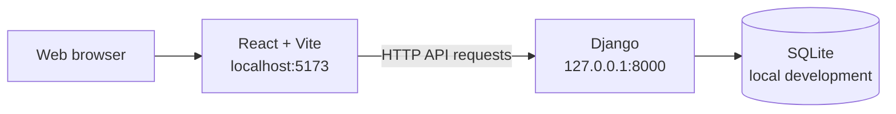

# Architecture

## Overview

bam-_boo_! is a full-stack web application with two independently run development services:

- A React frontend built and served by Vite.
- A Django backend that exposes HTTP endpoints and provides the Django admin site.

The frontend and backend are intentionally separated so that each can be developed, tested, and built with its own toolchain.

## Continuous integration

`.github/workflows/ci.yml` runs on pushes, pull requests, and manual dispatches. Independent Ubuntu jobs use Node 24 for the frontend and Python 3.14 for the backend, with npm and pip download caches keyed by their dependency files. The frontend job installs with `npm ci`, runs the existing Node tests, checks formatting and JavaScript/TypeScript lint, and builds the production bundle. The backend job installs pinned requirements, checks Django configuration and Black formatting, checks for missing migrations, and runs Django tests with an isolated test database created and migrated by the test runner. No database service or secrets are required. The workflow validates changes; deployment is not configured.

## Local Git hooks

`.githooks/pre-commit` is a shared Bash hook that runs the same validation commands as CI against the entire working tree before each commit. Developers enable it per clone with `git config --local core.hooksPath .githooks` after installing dependencies. It uses local frontend dependencies, loads an installed nvm Node 24 when the shell runtime is unavailable, and selects a native backend environment. WSL development uses a Linux virtual environment at `backend/.venv`; the hook uses its `bin/python` interpreter. `BACKEND_PYTHON` overrides interpreter selection. Checks stop on the first failure and do not modify or stage source files. `.gitattributes` keeps hook scripts on LF line endings for Bash compatibility across platforms. GitHub Actions remains the validation gate for pull requests.

## System boundary



During local development, Vite serves the frontend and Django runs the backend separately. Vite proxies `/api/` and `/media/` requests to `http://127.0.0.1:8000`, so the browser uses same-origin URLs for JSON, transcripts, and recorded MP3 audio. Django also allows the Vite development origin through `CORS_ALLOWED_ORIGINS`.

## Repository structure

```text
.githooks/
	pre-commit       Local frontend and backend validation before commits

.github/
	workflows/ci.yml  GitHub Actions frontend and backend validation
	CODEOWNERS       Ownership rules for frontend, backend, docs, and repository configuration
	pull_request_template.md  Default PR description with changes, screenshots, testing, setup notes, and future work

backend/
	challenges/       SQLite-backed challenges, conversation-tree validation, JSON API, local challenge import
	users/            User profiles and progress API
	media/challenges/ Imported challenge packages grouped by slug (local, not committed)
	challenges/source_data/challenges/  Authored local challenge packages and manifests
	counter/
		models.py       Persisted shared bam/boo count
		views.py        JSON read and update endpoints
		migrations/     Database schema migrations
	config/
		settings.py     Django settings, middleware, CORS, and database configuration
		urls.py         Root, health, and admin routes
		asgi.py         ASGI entry point
		wsgi.py         WSGI entry point
	manage.py         Django command-line entry point
	requirements.txt  Python dependencies
	pyproject.toml    Black formatter configuration
	db.sqlite3        Local database created by migrations (not committed)

data/
	sample-scenario.json  Legacy prototype fixture; no longer imported by the frontend

frontend/
	src/
		main.tsx        React application entry point
		App.tsx         Top-level training flow and page navigation
		pages/          Home, challenge, and results page components
		components/     Shared interface components and icons
		challenges.ts   Challenge API client and transcript hydration
		conversation.ts Branch traversal and answer matching
		routes.ts       Routes derived from the loaded challenge date
		types.ts        Shared frontend flow types
	    index.css       Tailwind CSS import and global styles
			assets/         Frontend image and SVG assets
	tests/            Node route tests using native TypeScript support
	package.json      npm scripts and dependencies
	prettier.config.ts Prettier and Tailwind class-sorting configuration
	.prettierignore   Prettier exclusions
	tsconfig*.json    TypeScript configuration for app and build tooling
	vite.config.ts    Vite and Tailwind configuration

docs/
	ARCHITECTURE.md   Current system design and ownership boundaries
	SETUP.md          Local installation and run instructions
	CONTRIBUTING.md   Contribution and commit guidance
	CHALLENGES.md     Local challenge package layout and authoring/import workflow
```

## Frontend

The frontend is written in TypeScript. Its entry point is `frontend/src/main.tsx`; it mounts the root `App` component into the page and loads `frontend/src/index.css`. Training content comes from the Django challenge API and SQLite. `challenges.ts` loads the challenge list, selects the `forgot-password-x3` demo when present (otherwise the first challenge), fetches its detail, and loads the referenced transcripts in parallel. Media URLs resolve from the origin root so direct visits to nested challenge routes work. Loading, retry, empty-database, and missing-transcript states are explicit; there is no static-scenario fallback. The interface is styled with Tailwind CSS utility classes in React components; `frontend/src/index.css` imports Tailwind and contains only global CSS rules.

Use npm scripts from the `frontend` directory:

- `npm test`: run frontend route tests directly using Node 24’s built-in test runner and TypeScript support.
- `npm run dev`: start the Vite development server on port `5173`.
- `npm test`: run the API-loading, branch-traversal, and answer-matching tests with Node’s built-in test runner (Node 22.18+ or 24+).
- `npm run build`: type-check the frontend and create a production build in `frontend/dist`.
- `npm run lint`: run the configured frontend linter.
- `npm run preview`: preview the production build locally.

Tailwind CSS is integrated through `@tailwindcss/vite` in `frontend/vite.config.ts`. Add UI styling with Tailwind utility classes rather than introducing component-specific CSS files unless a custom CSS rule is necessary.

Frontend build tooling uses `@types/node` for the Node.js APIs in Vite configuration.

Python formatting is enforced with Black using `backend/pyproject.toml`. Frontend formatting is enforced with Prettier and `prettier-plugin-tailwindcss`; Oxlint remains available as `npm run lint:js` for TypeScript and JavaScript quality checks.

The frontend uses browser history for its prototype routes: `/` renders the calendar, `/challenges/:date` renders the assigned challenge, and `/challenges/:date/complete` renders that challenge's results. The challenge date comes from the loaded challenge. Result feedback is retained in session storage with its challenge ID to support a results-page reload during the same browser session.

The challenge has tone, conversation, and next-action stages. Conversation history starts at the tree root (a customer/question node). Selecting an agent/response child appends that response and its recorded customer follow-up, then exposes only that follow-up’s available replies. The bundled demo has three paths with two agent turns each and one customer continuation per agent node. Reaching a leaf unlocks the next-action stage. Both speakers have native MP3 controls and visible transcripts; selected agent audio plays before the customer follow-up, subject to browser autoplay permissions. Tone and action feedback use whole-word matching against the loaded challenge’s `tone` and `required_action` values.

The Vite development proxy supplies both API and media access. Production hosting must also route `/api/` to Django and `/media/` to the stored recordings; Django’s development media serving is not a production media server.

## Backend

The Django project is configured in `backend/config`:

- `settings.py` enables Django’s built-in apps, `django-cors-headers`, and SQLite.
- `counter/` owns the shared count model and its JSON API.
- `challenges/` owns dated challenges, their alternating question/response JSON trees, API serialization, `import_challenges`, and the compatibility `seed_kale_demo` command. Each challenge has a unique, stable slug, a unique name, and its existing numeric database ID. Changing the name or schedule date does not change the slug. SQLite stores metadata and per-turn filenames; UTF-8 transcripts and MP3s remain local files. Authored packages live in `backend/challenges/source_data/challenges/<slug>/`, with `<slug>.json`, flat `audio/`, and flat `transcripts/` folders. The folder name must match the challenge slug. The importer validates selected packages and stages each complete package under `backend/media/challenges/<slug>/`. Replacement preserves database IDs and restores old files if saving fails. See [CHALLENGES.md](CHALLENGES.md) for the manifest and authoring workflow.
- `tone/` owns the word embeddings used by the backend to find similar words. The files are uploaded to the database and can be renamed within the tone folder (using `manage.py`). Its tone-similarity endpoint is scaffolded but not implemented.
- `users/` owns user profiles, progress endpoints, and session authentication. `forms.py` extends Django's `UserCreationForm` to validate signup credentials and optional email; `views.py` uses Django's `authenticate`, `login`, and `logout` functions with the existing database session backend.
- `urls.py` currently defines the following routes:
  - `/`: backend service status JSON.
  - `/api/health/`: health status JSON.
  - `/api/count/`: `GET` the saved count or `POST` a `delta` of `1` or `-1`.
  - `/api/challenges/`: list saved challenges with numeric `id`, unique `slug`, and display name; optionally filter by category. Fuzzy name matching with strict date/difficulty filters is scaffolded but commented out.
  - `/api/challenges/<id>/`: challenge detail, required action, and the full conversation tree with transcript/audio URLs.
  - `/api/challenges/<slug>/`: scaffolded challenge detail by slug; returns `501` until implemented.
  - `/api/users/<id>/profile/`: existing user profile endpoint.
  - `/api/users/<username>/`: scaffolded `GET`/`POST` user read and update endpoint; returns `501` until implemented.
  - `/api/users/leaderboard/`: top ten users by total score.
  - `/api/users/auth/csrf/`: `GET` a CSRF token and set the CSRF cookie.
  - `/api/users/auth/signup/`: `POST` signup credentials, create an account/profile, and start a session.
  - `/api/users/auth/login/`: `POST` credentials and start a session.
  - `/api/users/auth/logout/`: `POST` to flush the session.
  - `/api/users/auth/me/`: `GET` the current account, or `401` when anonymous.
  - `/api/tone/<tone1>&<tone2>/`: scaffolded tone-similarity endpoint; returns `501` until implemented.
  - `/media/`: local development transcript and MP3 serving when `DEBUG` is enabled.
  - `/admin/`: Django admin.
- `manage.py` is the entry point for checks, migrations, and the development server.

Backend dependencies are pinned in `backend/requirements.txt`. Run Django commands through the repository virtual environment.

### Session authentication API

Authentication uses Django's built-in `User`, its hashed passwords, and the existing one-to-one `UserProfile`. The existing signal creates the profile on signup. No additional dependencies or schema migrations are required. Profile and leaderboard reads retain their existing public behavior.

Use same-origin `/api/` URLs through the Vite proxy. `CSRF_TRUSTED_ORIGINS` permits `http://localhost:5173` because proxied browser requests retain that Origin header. Direct cross-origin frontend requests to port 8000 are not the supported browser flow.

| Method | Path | Request | Success |
| --- | --- | --- | --- |
| GET | `/api/users/auth/csrf/` | None | `200`, `{"csrfToken": "..."}` and a `csrftoken` cookie |
| POST | `/api/users/auth/signup/` | JSON `username`, `password`, optional `email` | `201`, account and CSRF token; sets session cookie |
| POST | `/api/users/auth/login/` | JSON `username`, `password` | `200`, account and CSRF token; sets session cookie |
| POST | `/api/users/auth/logout/` | No body required | `200`, `{"detail": "Logged out."}`; clears session, including for an already anonymous client |
| GET | `/api/users/auth/me/` | None | `200`, account and CSRF token |

Account responses have the shape `{"user": {"id": 7, "username": "ada", "email": "ada@example.com"}, "csrfToken": "..."}`. Passwords and permissions are never included. All authentication responses disable caching. Signup accepts only username, password, and email; additional properties cannot grant privileges. Email is optional and is not a unique account identifier; login uses username. Signup applies Django's username, email, duplicate-username, and configured password validation. It returns `400` with `{"errors": {"field": ["message"]}}` for form validation failures. Malformed JSON, non-object bodies, missing credentials, non-string credential fields, or a content type other than `application/json` return `400` with `{"detail": "..."}`. Invalid credentials and inactive accounts return the same generic `401` response. Anonymous `/me/` requests return `401`. Unsupported HTTP methods return `405`.

Every authentication POST, including anonymous signup/login/logout, requires the CSRF cookie and an `X-CSRFToken` header. Missing or invalid tokens and untrusted origins return Django's standard `403` response, which may be HTML. Fetch `/csrf/` before the first POST. Successful signup/login rotates the CSRF secret, so replace your saved token with the returned `csrfToken` before the next POST. Cookies identify the session on later requests; `/me/` lets the frontend restore its signed-in state after reload. Authentication does not automatically record dates in `UserProfile.login_days`.

Example browser flow (with Vite and Django running):

```javascript
let { csrfToken } = await fetch('/api/users/auth/csrf/').then((r) => r.json())

const response = await fetch('/api/users/auth/signup/', {
  method: 'POST',
  credentials: 'same-origin',
  headers: {
    'Content-Type': 'application/json',
    'X-CSRFToken': csrfToken,
  },
  body: JSON.stringify({
    username: 'ada',
    password: 'River!Quartz7Maple',
    email: 'ada@example.com',
  }),
})
const result = await response.json()
if (!response.ok) throw new Error(JSON.stringify(result))
csrfToken = result.csrfToken

// Login uses the same POST shape without email, at /api/users/auth/login/.
const currentAccount = await fetch('/api/users/auth/me/').then((r) => r.json())

await fetch('/api/users/auth/logout/', {
  method: 'POST',
  credentials: 'same-origin',
  headers: { 'X-CSRFToken': csrfToken },
})
```

See Django's [authentication documentation](https://docs.djangoproject.com/en/6.1/topics/auth/default/) and [AJAX CSRF guidance](https://docs.djangoproject.com/en/6.1/howto/csrf/) for the underlying session and token behavior.

## Data and persistence

Local development uses SQLite at `backend/db.sqlite3`. Django migrations are the source of truth for schema changes. Do not edit the database file directly or commit it to the repository. After migrations, run `backend/.venv/bin/python backend/manage.py import_challenges` to load all authored local packages. Pass challenge slugs to select packages, and `--replace` to update existing ones without deleting their database rows. Imports preserve existing numeric IDs. `seed_kale_demo` remains a shortcut for the bundled demo; `--force` delegates to replacement. Generated media is excluded from Git.

When models are introduced or changed:

1. Add or update the Django model.
2. Generate a migration with `manage.py makemigrations`.
3. Apply migrations with `manage.py migrate`.
4. Include the migration files in the change.

## Request flow

1. A user opens the Vite-served React application in a browser.
2. React renders the current application route.
3. Frontend features call Django HTTP endpoints under the backend origin.
4. Django URL routing dispatches requests to views or installed Django applications.
5. Backend code reads or writes SQLite through Django’s ORM when persistence is required.
6. Django returns JSON or an appropriate HTTP response to the frontend.

## Architectural conventions

- Keep UI rendering and browser interaction in `frontend/`.
- Keep API routing, validation, business logic, persistence, and administration in `backend/`.
- Prefer explicit API boundaries over sharing implementation details between frontend and backend.
- Add frontend dependencies to `frontend/package.json` and backend dependencies to `backend/requirements.txt`.
- Keep local-only files such as virtual environments, SQLite databases, `node_modules`, and build output out of version control.

## Keeping this document current

Update this document in the same change whenever a structural decision changes. In particular, update it when:

- A new Django app, API boundary, database model, or persistence technology is added.
- Frontend routing, state management, API client structure, or build behavior changes.
- A service, port, environment variable, or external dependency is added.
- A directory moves or a new top-level project area is introduced.

Architecture changes should be called out in pull requests and reflected in the relevant setup or contribution documentation.

Route tests import `routes.ts` directly with Node 24. The route module imports the shared scenario JSON with an explicit JSON import attribute, so tests need no Vite server, filesystem watcher, or native bundler. The frontend build validates Vite integration separately. Windows users run development commands and commits from WSL using the same Linux environment.

The pre-commit hook checks platform-specific local npm launchers for Prettier, Oxlint, TypeScript, and Vite before running frontend checks. Missing launchers require reinstalling development dependencies in the committing terminal; the hook does not download dependencies automatically.
