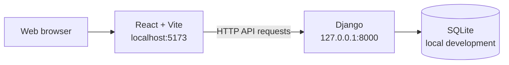

# Architecture

## Overview

bam-_boo_! is a full-stack web application with two independently run development services:

- A React frontend built and served by Vite.
- A Django backend that exposes HTTP endpoints and provides the Django admin site.

The frontend and backend are intentionally separated so that each can be developed, tested, and built with its own toolchain.

## Continuous integration

`.github/workflows/ci.yml` runs on pushes, pull requests, and manual dispatches. Independent Ubuntu jobs use Node 24 for the frontend and Python 3.14 for the backend, with npm and pip download caches keyed by their dependency files. The frontend job installs with `npm ci`, runs the existing Node tests, checks formatting and JavaScript/TypeScript lint, and builds the production bundle. The backend job installs pinned requirements, checks Django configuration and Black formatting, checks for missing migrations, and runs Django tests with an isolated test database created and migrated by the test runner. No database service or secrets are required. The workflow validates changes; deployment is not configured.

## Local Git hooks

`.githooks/pre-commit` is a shared Bash hook that runs the same validation commands as CI against the entire working tree before each commit. Developers enable it per clone with `git config --local core.hooksPath .githooks` after installing dependencies. It uses local frontend dependencies, loads an installed nvm Node 24 when the shell runtime is unavailable, and selects a native backend environment. WSL can use the ignored `backend/.venv-wsl` alongside a Windows `backend/.venv`; `BACKEND_PYTHON` overrides interpreter selection. Checks stop on the first failure and do not modify or stage source files. `.gitattributes` keeps hook scripts on LF line endings for Bash compatibility across platforms. GitHub Actions remains the validation gate for pull requests.

## System boundary



During local development, Vite serves the frontend and Django runs the backend separately. Django allows requests from the Vite development origin through `CORS_ALLOWED_ORIGINS`.

## Repository structure

```text
.githooks/
	pre-commit       Local frontend and backend validation before commits

.github/
	workflows/ci.yml  GitHub Actions frontend and backend validation
	CODEOWNERS       Ownership rules for frontend, backend, docs, and repository configuration
	pull_request_template.md  Default PR description with changes, screenshots, testing, setup notes, and future work

backend/
	counter/
		models.py       Persisted shared bam/boo count
		views.py        JSON read and update endpoints
		migrations/     Database schema migrations
	config/
		settings.py     Django settings, middleware, CORS, and database configuration
		urls.py         Root, health, and admin routes
		asgi.py         ASGI entry point
		wsgi.py         WSGI entry point
	manage.py         Django command-line entry point
	requirements.txt  Python dependencies
	pyproject.toml    Black formatter configuration
	db.sqlite3        Local database created by migrations (not committed)

data/
	sample-scenario.json  Presimulated training scenario used by the prototype

frontend/
	src/
		main.tsx        React application entry point
		App.tsx         Top-level training flow and page navigation
		pages/          Home, level, and results page components
		components/     Shared interface components and icons
		scenario.ts     Shared import for repository-level scenario data
		types.ts        Shared frontend flow types
	    index.css       Tailwind CSS import and global styles
			assets/         Frontend image and SVG assets
	tests/            Node route tests using native TypeScript support
	package.json      npm scripts and dependencies
	prettier.config.ts Prettier and Tailwind class-sorting configuration
	.prettierignore   Prettier exclusions
	tsconfig*.json    TypeScript configuration for app and build tooling
	vite.config.ts    Vite and Tailwind configuration

docs/
	ARCHITECTURE.md   Current system design and ownership boundaries
	SETUP.md          Local installation and run instructions
	CONTRIBUTING.md   Contribution and commit guidance
```

## Frontend

The frontend is written in TypeScript. Its entry point is `frontend/src/main.tsx`; it mounts the root `App` component into the page and loads `frontend/src/index.css`. Presimulated training content is stored as repository-level JSON in `data/` and imported by the interface. Vite's development filesystem allowlist includes only this shared data directory so the frontend can read file-backed content without moving it into the frontend or database. The interface is styled with Tailwind CSS utility classes in React components; `frontend/src/index.css` imports Tailwind and contains only global CSS rules.

Use npm scripts from the `frontend` directory:

- `npm test`: run frontend route tests directly using Node 24’s built-in test runner and TypeScript support.
- `npm run dev`: start the Vite development server on port `5173`.
- `npm run build`: type-check the frontend and create a production build in `frontend/dist`.
- `npm run lint`: run the configured frontend linter.
- `npm run preview`: preview the production build locally.

Tailwind CSS is integrated through `@tailwindcss/vite` in `frontend/vite.config.ts`. Add UI styling with Tailwind utility classes rather than introducing component-specific CSS files unless a custom CSS rule is necessary.

Frontend build tooling uses `@types/node` for the Node.js APIs in Vite configuration.

Python formatting is enforced with Black using `backend/pyproject.toml`. Frontend formatting is enforced with Prettier and `prettier-plugin-tailwindcss`; Oxlint remains available as `npm run lint:js` for TypeScript and JavaScript quality checks.

The frontend uses browser history for its prototype routes: `/` renders the calendar, `/levels/:date` renders the assigned level, and `/levels/:date/complete` renders that level's results. The current level date is read from the repository-level scenario JSON; result feedback is retained in session storage to support a results-page reload during the same browser session.

## Backend

The Django project is configured in `backend/config`:

- `settings.py` enables Django’s built-in apps, `django-cors-headers`, and SQLite.
- `counter/` owns the shared count model and its JSON API.
- `urls.py` currently defines the following routes:
  - `/`: backend service status JSON.
  - `/api/health/`: health status JSON.
  - `/api/count/`: `GET` the saved count or `POST` a `delta` of `1` or `-1`.
  - `/admin/`: Django admin.
- `manage.py` is the entry point for checks, migrations, and the development server.

Backend dependencies are pinned in `backend/requirements.txt`. Run Django commands through the repository virtual environment.

## Data and persistence

Local development uses SQLite at `backend/db.sqlite3`. Django migrations are the source of truth for schema changes. Do not edit the database file directly or commit it to the repository.

When models are introduced or changed:

1. Add or update the Django model.
2. Generate a migration with `manage.py makemigrations`.
3. Apply migrations with `manage.py migrate`.
4. Include the migration files in the change.

## Request flow

1. A user opens the Vite-served React application in a browser.
2. React renders the current application route.
3. Frontend features call Django HTTP endpoints under the backend origin.
4. Django URL routing dispatches requests to views or installed Django applications.
5. Backend code reads or writes SQLite through Django’s ORM when persistence is required.
6. Django returns JSON or an appropriate HTTP response to the frontend.

## Architectural conventions

- Keep UI rendering and browser interaction in `frontend/`.
- Keep API routing, validation, business logic, persistence, and administration in `backend/`.
- Prefer explicit API boundaries over sharing implementation details between frontend and backend.
- Add frontend dependencies to `frontend/package.json` and backend dependencies to `backend/requirements.txt`.
- Keep local-only files such as virtual environments, SQLite databases, `node_modules`, and build output out of version control.

## Keeping this document current

Update this document in the same change whenever a structural decision changes. In particular, update it when:

- A new Django app, API boundary, database model, or persistence technology is added.
- Frontend routing, state management, API client structure, or build behavior changes.
- A service, port, environment variable, or external dependency is added.
- A directory moves or a new top-level project area is introduced.

Architecture changes should be called out in pull requests and reflected in the relevant setup or contribution documentation.

Route tests import `routes.ts` directly with Node 24. The route module imports the shared scenario JSON with an explicit JSON import attribute, so tests need no Vite server, filesystem watcher, or native bundler. The frontend build validates Vite integration separately. Git Bash prefers the Windows backend virtual environment when both Windows and WSL environments exist.

The pre-commit hook checks platform-specific local npm launchers for Prettier, Oxlint, TypeScript, and Vite before running frontend checks. Missing launchers require reinstalling development dependencies in the committing terminal; the hook does not download dependencies automatically.
