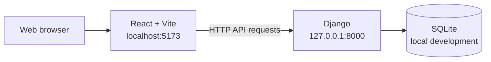

# Architecture

## Overview

bam-_boo_! is a full-stack web application with two independently run development services:

- A React frontend built and served by Vite.
- A Django backend that exposes HTTP endpoints and provides the Django admin site.

The frontend and backend are intentionally separated so that each can be developed, tested, and built with its own toolchain.

## Continuous integration

`.github/workflows/ci.yml` runs on pushes, pull requests, and manual dispatches. Independent Ubuntu jobs use Node 24 for the frontend and Python 3.14 for the backend, with npm and pip download caches keyed by their dependency files. The frontend job installs with `npm ci`, runs the existing Node tests, checks formatting and JavaScript/TypeScript lint, and builds the production bundle. The backend job installs pinned requirements, checks Django configuration and Black formatting, checks for missing migrations, and runs Django tests with an isolated test database created and migrated by the test runner. No database service or secrets are required. The workflow validates changes; deployment is not configured.

## Local Git hooks

`.githooks/pre-commit` is a shared Bash hook that runs the same validation commands as CI against the entire working tree before each commit. Developers enable it per clone with `git config --local core.hooksPath .githooks` after installing dependencies. It uses local frontend dependencies, loads an installed nvm Node 24 when the shell runtime is unavailable, and selects a native backend environment. WSL development uses a Linux virtual environment at `backend/.venv`; the hook uses its `bin/python` interpreter. `BACKEND_PYTHON` overrides interpreter selection. Checks stop on the first failure and do not modify or stage source files. `.gitattributes` keeps hook scripts on LF line endings for Bash compatibility across platforms. GitHub Actions remains the validation gate for pull requests.

## System boundary



During local development, Vite serves the frontend and Django runs the backend separately. Vite proxies `/api/` and `/media/` requests to `http://127.0.0.1:8000`, so the browser uses same-origin URLs for JSON, transcripts, and recorded MP3 audio. Django also allows the Vite development origin through `CORS_ALLOWED_ORIGINS`.

## Repository structure

```text
.githooks/
	pre-commit       Local frontend and backend validation before commits

.github/
	workflows/ci.yml  GitHub Actions frontend and backend validation
	CODEOWNERS       Ownership rules for frontend, backend, docs, and repository configuration
	pull_request_template.md  Default PR description with changes, screenshots, testing, setup notes, and future work

backend/
	challenges/       SQLite-backed challenges, tree validation, JSON and calendar APIs, imports, admin upload, production validation
		domain/         Framework-free Challenge and ConversationNode entities, package rules, and the calendar clock
		use_cases/      Challenge ports plus BrowseChallenges, ImportChallengePackage, and ValidateChallenges
		adapters/       Django repositories, calendar data access, controllers, presenters, package storage, and validation adapters
	play/             Challenge-run and score domain, use cases, repository ports, and Django adapters
		domain/         Framework-free Attempt, Run, AnswerMatching, and StarRules entities
		use_cases/      Challenge-run and completed-attempt interactors and ports
		adapters/       Run and attempt repositories, controllers, presenters, and tone matcher
	users/            User profiles, progress API, and session authentication
		domain/         Framework-free Profile entity
		use_cases/      Profile, auth, and group ports
		adapters/       Split authentication and progress endpoint adapters
	tone/             Numberbatch vector storage and import command used by the play tone-matcher adapter
		domain/         Tone domain foundation
		use_cases/      Tone-vector repository port
		adapters/       Tone interface-adapter foundation
	media/challenges/ Imported challenge packages grouped by slug (local, not committed)
	challenges/source_data/challenges/  Authored local challenge packages and manifests
	config/
		container.py    Composition boundary for injected adapters
		settings.py     Django settings, middleware, CORS, and database configuration
		urls.py         Root, health, and admin routes
		asgi.py         ASGI entry point
		wsgi.py         WSGI entry point
	manage.py         Django command-line entry point
	requirements.txt  Python dependencies
	pyproject.toml    Black formatter configuration
	db.sqlite3        Local database created by migrations (not committed)

data/
	sample-scenario.json  Legacy prototype fixture; no longer imported by the frontend

frontend/
	src/
		main.tsx        React application entry point
		App.tsx         Top-level training flow, summaries loading, and page navigation
		pages/          Home, challenge, results, authentication, and profile pages plus the challenge, results, home, profile, and auth composition hooks
		components/     Shared interface components and icons
		entities/      Challenge session, result summary, daily-challenge selection, login streak, user profile progress, auth credentials, calendar entries, and domain types (framework-free)
		challenge/      Challenge route application code; future routes follow the same layout
			boundaries/    Output boundary, challenge/attempt gateway interfaces, and attempt storage
			components/    Challenge stage views and audio player
			dataAccessInterface/  Challenge and attempt gateways, attempt storage, browser services
			viewModels/    Challenge view-model mapper (framework-free)
			useCases/      One folder per challenge use case with its interactor, boundaries, and presenter
		dataAccessInterface/  Shared JSON/CSRF HTTP client and ApiError
		home/          Home route application code
			boundaries/    Profile, leaderboard, and challenge (calendar) gateway interfaces
			components/    Daily challenge card, calendar grid, leaderboard
			dataAccessInterface/  Profile and leaderboard gateways, and the challenge gateway (challengeApi.ts)
			viewModels/    Home view models and display formatting
			useCases/      loadTodayChallenge, browseChallenges, loadLeaderboard (interactor, boundaries, presenter)
		profile/       Profile route application code
			boundaries/    Profile gateway interface
			components/    Account details, profile stats, score table
			dataAccessInterface/  Profile gateway
			viewModels/    Profile view model and avatar formatting
			useCases/      loadUserProfile (interactor, boundaries, presenter)
		results/       Results route application code
			boundaries/    Result claim gateway and retained-result storage interfaces
			components/    Result summary, achievements, save status, and actions
			dataAccessInterface/  Claim endpoint and sessionStorage result service
			viewModels/    Results and claim-state view models
			useCases/      restoreChallengeResult and claimChallengeResult (interactor, boundaries, presenter)
		viewModels/     Cross-feature view-model formatting (challenge dates, framework-free)
		auth/          Account session, authentication, and groups
			boundaries/    Session, authentication, logout, and signup-group interfaces
			components/    Login/signup form
			dataAccessInterface/  CSRF/session endpoints and signup groups
			viewModels/    Session, form, groups, and logout view models
			useCases/      restoreSession, authenticateUser, logoutUser, loadSignupGroups
		routes.ts       Route parsing helpers for home, challenge, results, auth, and profile
	    index.css       Tailwind import, design tokens (@theme), and global styles
			assets/         Frontend image and SVG assets
	tests/            API-loading, use case, entity, view-model, gateway, and offline-layout tests using native TypeScript support
	package.json      npm scripts and dependencies
	prettier.config.ts Prettier and Tailwind class-sorting configuration
	.prettierignore   Prettier exclusions
	tsconfig*.json    TypeScript configuration for app and build tooling
	vite.config.ts    Vite and Tailwind configuration

docs/
	ARCHITECTURE.md   Current system design and ownership boundaries
	SETUP.md          Local installation and run instructions
	CONTRIBUTING.md   Contribution and commit guidance
	CHALLENGES.md     Local challenge package layout and authoring/import workflow
```

## Frontend

The frontend is written in TypeScript. Its entry point is `frontend/src/main.tsx`; it mounts the root `App` component into the page and loads `frontend/src/index.css`. Training content comes from the Django challenge API and SQLite. `App.tsx` loads challenge summaries and selects the `forgot-password-x3` demo when present (otherwise the first challenge) for the route date; the calendar grid comes from the calendar endpoint. Entering a challenge hands its slug to the challenge page, whose Start Challenge use case resumes a stored attempt or creates a server-owned run through `challenge/dataAccessInterface/attemptGatewayApi.ts`; the opening and later turns are hydrated from their transcript URLs. Media URLs resolve from the origin root so direct visits to nested routes work. Summary and account failures use a compact inline notice in `App.tsx` with retry, while attempt failures surface inside the challenge page with their own retry action; there is no static-scenario fallback. Without challenge summaries, the home page shows the current month, an empty leaderboard/progress state, disabled calendar actions, and an empty recording card. Retrying failed requests restores real challenge/account data without reloading the page. The interface is styled with Tailwind CSS utility classes in React components. `frontend/src/index.css` imports Tailwind, defines the design tokens (brand colors, font, radius, shadow, and animation) in an @theme block, and contains global CSS rules. Use the token-based classes (for example bg-beige, text-orange, bg-green-light) instead of arbitrary hex values.

Use npm scripts from the `frontend` directory:

- `npm run dev`: start the Vite development server on port `5173`.
- `npm test`: run the use-case, entity, view-model, gateway, API, and offline-layout tests with Node 24's built-in test runner and TypeScript support.
- `npm run build`: type-check the frontend and create a production build in `frontend/dist`.
- `npm run lint`: check frontend formatting with Prettier.
- `npm run lint:js`: lint JavaScript and TypeScript with Oxlint.
- `npm run format`: apply Prettier formatting and Tailwind class sorting.
- `npm run preview`: preview the production build locally.

Tailwind CSS is integrated through `@tailwindcss/vite` in `frontend/vite.config.ts`. Add UI styling with Tailwind utility classes rather than introducing component-specific CSS files unless a custom CSS rule is necessary.

Frontend build tooling uses `@types/node` for the Node.js APIs in Vite configuration. `tsconfig.app.json` enables `allowImportingTsExtensions` so source modules can use explicit `.ts` import paths that both `tsc` and Node 24’s type-stripping test runner resolve.

Python formatting is enforced with Black using `backend/pyproject.toml`. Frontend formatting is enforced with Prettier and `prettier-plugin-tailwindcss`; Oxlint remains available as `npm run lint:js` for TypeScript and JavaScript quality checks.

The frontend uses browser history for its routes: `/` renders the calendar, `/challenges/:slug` renders the challenge with that slug, and `/challenges/:slug/complete` renders that challenge's results. The challenge route resumes an in-progress attempt id retained per slug in session storage or starts a new run; it does not fetch the conversation tree. A completed result is retained in session storage with its attempt id, challenge summary, server score, required action, and completion timestamp, so the results page reloads without creating another attempt. The results route restores and validates that result through the results slice; a missing or mismatched result shows an unavailable state instead of creating a new attempt.

`/login` and `/signup` render `AuthPage.tsx`; `/profile` renders `ProfilePage.tsx` for the signed-in user and the login form while the account is anonymous or unknown. Signed-in visitors to either authentication route see their profile. Account pages resolve independently of challenge loading, including when the database has no challenges or media is unavailable. `App.tsx` restores the account through `/api/users/auth/me/` on mount; session loading and connection failures keep the form visible with a small status notice and retry action. Authentication submission waits for the initial session check to finish, and fields remain editable. A failed session check permits a later login attempt. The home header links to login or the current user’s profile; there is no placeholder avatar. The streak is shown in the calendar header for now (see the home route below). Recordings remain available without signing in.

The `auth/` slice owns same-origin, cookie-based authentication. `pages/useAuthFlow.ts` composes `loadSignupGroups` and `authenticateUser` for `AuthPage`; `App.tsx` uses `restoreSession` on mount, and `pages/useProfileFlow.ts` uses `logoutUser` for profile logout. `auth/dataAccessInterface/authGatewayApi.ts` fetches a fresh CSRF token before each signup, login, or logout, so token rotation after login or a change in another tab does not leave a cached token; shared `dataAccessInterface/httpClient.ts` centralizes response parsing, CSRF-aware POSTs, and `ApiError`. Credentials, session identifiers, and CSRF tokens are not written to browser storage. Authentication errors and Django signup validation messages appear in the form; pending submissions disable inputs and the submit button. Requests made by page effects and sign-in forms are cancelled on unmount. Signup checks password confirmation through `entities/authCredentials.ts` before submitting.

The `profile/` slice loads the account through `profile/useCases/loadUserProfile/`, joins saved scores with seeded summaries in `entities/userProfileProgress.ts`, and formats the avatar and score rows in `profile/viewModels/profileViewModel.ts`; `pages/ProfilePage.tsx` is a thin controller. The profile displays the current account's username and email plus its stored avatar, total score, completed challenge count, and per-challenge scores from `/api/users/<id>/profile/`. Profile loading and logout failures have separate error states; profile reads can be retried and a failed logout retains the signed-in account. Successful logout clears the frontend account and locally retained challenge result, then opens login. Profile fields are read-only in the interface. Authenticated run completion is graded and saved by the backend in one transaction; the frontend then claims completed results while signed in so a run started anonymously before login is also recorded. Results retain the completing account's ID (or `null` for a guest), the attempt id, the completed challenge summary, server score, required action, and completion timestamp in browser session storage. The results page shows saving, saved, and retryable failure states; a session expiry prompts login again. A guest can sign in or sign up to claim their pending result, but a result assigned to another account is not claimed. Saving continues when navigating from results to the calendar or profile, and the profile reloads progress when a save finishes. Reloading a retained result reuses the same attempt id, so claiming is idempotent and does not duplicate attempt history. A newly completed replay creates a new run and attempt, even when its score is lower. The profile displays only best scores, while Django admin exposes every attempt with its completion and receipt timestamps. API-client and route tests cover session restoration, authentication requests, fresh CSRF tokens, validation failures, HTML errors, cancellation, profile reads, and account routing without challenge data. Offline-layout regression tests bundle the app in memory with Vite and render it using React's server renderer to check that the calendar and authentication forms render without waiting for backend requests; these checks add no dependencies and do not start a server.

The home route follows the same Clean Architecture pattern. `pages/useHomeFlow.ts` composes three use cases: `loadTodayChallenge` selects the seeded summary through `entities/dailyChallenge.ts`, `browseChallenges` loads one month of the calendar, and `loadLeaderboard` loads ranked users through the leaderboard gateway. `browseChallenges` takes a year and month, asks the `HomeChallengeGateway` (`home/dataAccessInterface/challengeApi.ts`) for that month through `GET /api/calendar/`, and returns one `CalendarEntry` per day (`entities/calendarEntry.ts`) with the status and stars the server decided, plus the challenge summary when the day has one. The frontend displays these values and does not compute statuses or stars. The interactor rejects months outside 1 to 12 without calling the gateway, reports gateway failures through its presenter, and presents nothing once its request is aborted. The displayed month is derived, not stored: `resolveCalendarMonth` uses the month the user last chose with the ‹ and › buttons (stepped by `shiftMonth`) and otherwise follows the reference date, so the calendar moves to the selected challenge's month when the summaries finish loading and never overrides a manual choice afterwards. `home/viewModels/homeViewModel.ts` builds the Sunday-first grid from the month itself and places each entry by its date, so a short, empty, or unsorted response cannot shift days into the wrong cells. "Today" is `calendarToday()`, the current date in the shared calendar time zone (`CALENDAR_TIME_ZONE`, America/Toronto), the same zone the backend uses to decide which day is available. The streak is derived in `useHomeFlow` from the signed-in user's login days and shown in the calendar header; the page header is not wired to it yet. Each use case has its own presenter and view-model mapper; `pages/HomePage.tsx` wires them into `home/components/` and renders the calendar grid immediately with disabled day cells before the month arrives, while the month buttons stay enabled. The use cases, month helpers, and calendar view model are unit-tested with fakes and need no React, browser, or server.

The challenge route follows Clean Architecture with source dependencies pointing inward only. `entities/` holds the framework-free state: the `ChallengeSession` entity in `challengeSession.ts` wraps the latest `AttemptSnapshot`, owns local drafts and pending/error presentation state, and exposes pure audio and result helpers; `types.ts` defines attempt turns, choices, snapshots, result data, and challenge summaries. There is no frontend conversation tree, answer matching, tone timing, or star calculation. `challenge/useCases/` holds one folder per use case — `startChallenge/` (resumes a stored attempt or starts a server run), `submitTone/` (posts the tone answer and applies the returned snapshot), `advanceConversation/` (choice selection, choice submission, continue, and audio chaining), and `completeChallenge/` (posts the action answer and builds the completion result) — each containing its interactor, input boundary DTOs, and presenter. The shared output boundary lives in `challenge/boundaries/challengeOutputBoundary.ts`, and the `ChallengeGateway`, `AttemptGateway`, and `AttemptStorage` interfaces in `challenge/boundaries/dataAccessInterfaces.ts`; `challenge/dataAccessInterface/` implements them (`challengeGatewayApi.ts`, `attemptGatewayApi.ts`, `attemptStorage.ts`, and `browserServices.ts` for scrolling). `challenge/viewModels/challengeViewModel.ts` converts attempt snapshots into display-ready view values (options, finished flag, step number, progress), and `pages/useChallengeFlow.ts` composes each use case's presenter, gateways, storage, and interactors behind their input boundaries for the page. `viewModels/challengeDatePresenter.ts` is shared by challenge, home, results, and profile view models to format challenge dates. React components in `challenge/components/` render one view model per stage; `pages/ChallengePage.tsx` is a thin controller that owns only browser concerns (AbortControllers, scrolling, completion navigation). The interactors and entity are unit-tested with fakes in `tests/` without React or a browser.

The backend owns the tone, conversation, action, and completed stages. Starting or resuming a run returns the opening node; tone grading returns the conversation and current response choices; selecting a choice returns the updated history and next choices; continuing with no choices opens the action stage; and submitting the action returns the completed snapshot with `action_correct`, `score`, `required_action`, `completed_at`, `user_id`, and `saved`. Authenticated completions record their attempt and profile score in the run transaction; the snapshot marks those results saved so the results flow does not submit a duplicate claim. Guest completions remain claimable through the score endpoint, whose adapter dispatches to the record-attempt use case. Snapshots expose only the opening, already-seen conversation, and current choices, never future nodes or the reference tone. Both speakers have native MP3 controls and visible transcripts; selected agent audio plays before the customer follow-up, subject to browser autoplay permissions. Tone submission sends only the answer, and the backend grades it at cosine similarity >= 0.65 while storing the elapsed tone time. Action grading uses whole-word matching against the challenge’s private required action. Submissions disable repeated requests and surface unknown-tone, stale-stage, ownership, and service failures as retryable inline errors. Requests are cancelled on unmount.

The results route follows the same Clean Architecture boundary. `entities/challengeResultSummary.ts` validates and normalizes retained result data, decides claim eligibility (`checking`, `guest`, `saved`, `other-account`, `invalid`, or `claimable`), and exposes server-graded achievement/star values. `results/useCases/restoreChallengeResult/` accepts an optional in-memory seed or loads session storage through `ResultStorage`, verifies the route slug, persists a fresh completion seed, and presents the results view model. `results/useCases/claimChallengeResult/` posts only the attempt id through `ResultClaimGateway`, marks the result saved, and updates storage; it skips guests, saved results, invalid results, and results owned by another account. `pages/useResultsFlow.ts` is composed by `App` so a claim continues when the user leaves results for home, profile, or login. The hook restores the retained result for background claiming, accepts the freshly completed result as a seed, retries claims, clears the retained result on logout, and exposes display-ready results and claim view models. `results/viewModels/resultsViewModel.ts` owns achievement text, headings, date labels, save messages, and link/retry flags. `pages/ResultsPage.tsx` is a thin view over `results/components/` and receives no domain result or account objects.

Vite enables polling for file watching so source changes in mounted Windows workspaces invalidate its transformed-module cache. Restart Vite once after changing this configuration. The Vite development proxy supplies both API and media access. Production hosting must also route `/api/` to Django and `/media/` to the stored recordings; Django’s development media serving is not a production media server.

## Backend

The backend is being migrated toward Clean Architecture: framework-free entities live in `challenges/domain/`, `play/domain/`, and `users/domain/`; use-case port protocols live in each feature's `use_cases/` package; and Django, ORM, vector, filesystem, and HTTP code stays in adapters. User authentication and progress endpoints live in `users/adapters/views.py`, with `users/views.py` retained as a compatibility export. The `play/` Django app owns challenge-run and scoring behavior. Migrated backend folders use camelCase and class-focused files use PascalCase, with Django `test_*.py` modules as the discovery exception; see [CONTRIBUTING.md](CONTRIBUTING.md#backend-naming).

`ManageChallengeRun` owns starting runs, reading snapshots, grading tone and action answers, traversing conversation choices, and completing runs. Its interactor, input/output data, and boundaries live in `play/use_cases/manageChallengeRun/`; its controller and presenter live in the matching `play/adapters/manageChallengeRun/` folder. The interactor depends on `ChallengeRepository`, `RunRepository`, `AttemptRepository`, `ProfileRepository`, `ToneMatcher`, and `UnitOfWork` ports. The presenter serializes snapshots and maps semantic failures to HTTP statuses. The Django views only parse request bodies, invoke the use case, and return presenter output. A completion locks and revalidates the run, then saves its completed state, history record, and profile score within one unit-of-work transaction.

`RecordChallengeAttempt` remains the validated score-submission use case in `play/use_cases/recordChallengeAttempt/`, sharing the challenge, attempt, profile, and unit-of-work ports. The active `/api/users/me/scores/<slug>/` claim endpoint currently lives in `users/adapters/views.py` and derives the attempt from a completed `ChallengeRun` instead of trusting client-supplied metrics. Django implementations live in `challenges/adapters/repositories.py`, `play/adapters/repositories.py`, `users/adapters/repositories.py`, and `play/adapters/unit_of_work.py`. `config/container.py` composes the play use cases from those adapters. The ORM models and migrations stay in `play/`, `users/`, and `challenges/`.

`BrowseChallenges` is the calendar-browsing use case. Its input and output data, boundaries, interactor, and data access interface live in `challenges/use_cases/browseChallenges/` and depend only on domain types; the interactor imports no Django. For a requested year and month it returns one calendar day for each day of the month and decides each day’s status: `completed` when the user has a best score for that day’s challenge (with stars from 0 to 3), `available` when the day’s challenge is today’s and not completed, `upcoming` for a future challenge, `missed` for a past challenge with no score, and `none` for a day without a challenge. Today’s date comes from an injected clock so tests do not depend on the real date, and years outside 1 to 9999 or months outside 1 to 12 fail through the output boundary. The Django data access and presenter in `challenges/adapters/` read the month’s challenges and the signed-in user’s best scores and shape the JSON. Unlike the container-built use cases, `calendar_view` in `challenges/adapters/views.py` currently constructs this interactor, data access, and presenter directly.

`ImportChallengePackage` is the migrated content-admin use case. Its input/output data, boundaries, and interactor live in `challenges/use_cases/importChallengePackage/` and depend only on the framework-free `Challenge` entity and the `ChallengeRepository`, `PackageSource`, `PackageArchiveExtractor`, `AudioValidator`, and `MediaStore` ports plus the shared `UnitOfWork`. The interactor validates every package before saving anything, rejects duplicate names, slugs, or schedule dates within a batch, skips existing challenges before loading or validating their packages when requested, checks existing names through the repository port, and reports invalid packages, duplicate metadata, existing names or slugs, and repository save failures as semantic failures. A schedule date already used by another challenge is rejected by the unique database constraint when saving, which rolls back the whole batch. `challenges/adapters/importChallengePackage/` holds its controller and presenter; the presenter builds a view model with a display message and per-package results. Framework implementations of the new ports live in `challenges/adapters/PackageSource.py`, `challenges/adapters/archives.py`, `challenges/adapters/AudioValidator.py`, and `challenges/adapters/MediaStore.py`. `config/container.py` wires the use case; the CLI command and the staff admin view both call its controller, and `challenges/importer.py` remains as a compatibility facade for existing imports. The public URLs, audit history, and package layout are unchanged; the schema change is the unique schedule date described under migrations below.

`ValidateChallenges` is the migrated production-readiness use case. Its input/output data, boundaries, and interactor live in `challenges/use_cases/validateChallenges/` and depend only on the shared `ChallengeValidationGateway` port. The interactor runs database and environment checks before per-challenge checks, skips per-challenge checks when earlier stages fail, and reports failures as a message plus an error list; `challenges/adapters/validateChallenges/` holds its controller and presenter. `DjangoChallengeValidator` in `challenges/adapters/ChallengeValidator.py` implements the gateway by enumerating challenge rows and delegating the database, environment, and row checks to `challenges/validation.py`, and `config/container.py` wires the use case. The `validate_challenges` command calls the controller, writes each error to stderr, and exits non-zero through `CommandError`. Callers that used `ChallengeDatabaseValidator.validate()` directly now build the use case through `get_container().build_validate_challenges_use_case()`; the composition root requires a `ChallengeValidationGateway` adapter. Database inspection, media checks, and CLI output are unchanged.

The Django project is configured in `backend/config`:

- `settings.py` enables Django’s built-in apps, `django-cors-headers`, and SQLite.
- `challenges/` owns dated challenges, their alternating question/response JSON trees, API serialization, package validation/installation, the `ImportChallenges` and `validate_challenges` commands, the compatibility `seed_kale_demo` command, and the staff-only admin ZIP import. Package loading lives in `challenges/package.py`, FFprobe checks in `challenges/audio.py`, serialization in `challenges/serialization.py`, and production-readiness checks in `challenges/validation.py`. Import orchestration lives in the `ImportChallengePackage` use case and production-readiness orchestration in the `ValidateChallenges` use case, with filesystem, ZIP, FFprobe, storage, and database-validation details behind the adapters in `challenges/adapters/`.
 The CLI reads `backend/challenges/source_data/challenges/<slug>/`, while the admin upload extracts and validates a ZIP in a temporary directory before installing. The admin import is disabled as a normal add form because a valid challenge requires a complete media package, and imported challenge fields are read-only so changes go through Replace and keep source and media synchronized. Each challenge has a unique, stable slug, a unique name, a unique schedule date, and an internal numeric database key that is not exposed by the API. Changing the name or schedule date does not change the slug. SQLite stores metadata and per-turn filenames; UTF-8 transcripts and MP3s remain local files. Authored packages live in `backend/challenges/source_data/challenges/<slug>/`, with `<slug>.json`, flat `audio/`, and flat `transcripts/` folders. The folder name must match the challenge slug. The importer validates selected packages and stages each complete package under both `backend/media/challenges/<slug>/` and `backend/challenges/source_data/challenges/<slug>/`; CLI imports skip the source copy because the package already lives there. Replacement preserves database IDs and restores old media and source files if saving fails. Every imported MP3 must pass `ffprobe` with an MP3 audio stream and positive duration. See [CHALLENGES.md](CHALLENGES.md) for the manifest and publishing workflow.
- `tone/` owns ConceptNet Numberbatch word embeddings stored as word/vector rows in SQLite. The `load_vectors` management command reads a compressed vector file from `data/numberbatch-en-19.08.txt.gz` or a `--file` path, downloading it if missing. It skips downloading and loading when any vectors already exist unless `--clear` is supplied to replace them. `play/adapters/VectorToneMatcher.py` decodes the stored little-endian float vectors and computes cosine similarity in [-1, 1] for `ManageChallengeRun`; there is no separate public tone route. Inputs are case-folded and punctuation/whitespace normalized to Numberbatch underscore phrases. An exact phrase embedding takes precedence; otherwise all component words must exist and their vectors are averaged before scoring. Negative cosine values are preserved. Unknown answer words fail semantically, while unloaded data, a missing reference embedding, or invalid/zero/mismatched vectors report tone-service unavailability through the play presenter. The backend owns the correctness threshold and obtains the reference tone exclusively from `Challenge.tone`. No new third-party tone dependencies are required.
- `users/` owns user profiles, progress endpoints, and session authentication. `forms.py` extends Django's `UserCreationForm` to validate signup credentials, optional email, and an optional existing group; the auth adapter uses Django's `authenticate`, `login`, and `logout` functions with the existing database session backend.
- `play/` owns framework-free play entities (`Attempt`, `Run`, `StarRules`, and `AnswerMatching`), the run, attempt, and tone-matcher ports, and the `ManageChallengeRun` and `RecordChallengeAttempt` use cases. `ManageChallengeRun` owns state transitions and authenticated completion persistence. The active claim endpoint in `users/adapters/views.py` validates a completed `ChallengeRun` directly; `RecordChallengeAttempt` remains available for the older metrics-based application flow but is not routed publicly.
- `urls.py` currently defines the following routes:
  - `/`: backend service status JSON.
  - `/api/health/`: health status JSON.
  - `/api/challenges/`: list challenges by `slug`, `name`, `challenge_date`, `difficulty`, and `category`. `category`, `date`, and `difficulty` filters are strict; `name` uses ranked fuzzy matching; malformed filters return JSON `400`.
  - `/api/challenges/<slug>/`: public challenge metadata without the private tone, required action, or conversation tree.
  - `/api/challenges/<slug>/attempts/`: `POST` an empty JSON object to create a challenge run and receive its opening turn.
  - `/api/attempts/<uuid>/`: `GET` the current run snapshot; authenticated runs are visible only to their owner.
  - `/api/attempts/<uuid>/tone/`: `POST` an `answer` string to grade tone and advance to conversation.
  - `/api/attempts/<uuid>/choices/`: `POST` a `choice_id` string to select an available response.
  - `/api/attempts/<uuid>/continue/`: `POST` an empty JSON object after the conversation to advance to the action stage.
  - `/api/attempts/<uuid>/action/`: `POST` an `answer` string to grade the required action, complete the run, and persist an authenticated user's attempt and best score atomically.
  - `/api/calendar/?year=<YYYY>&month=<1-12>`: one entry per day of the month with its status, stars, and the day's challenge fields when it has one. Uses the session user's best scores when signed in. A missing or non-numeric `year` or `month`, a `year` outside 1 to 9999, or a `month` outside 1 to 12 returns JSON `400`.
  - `/api/users/<id>/profile/`: existing user profile endpoint.
  - `/api/users/<username>/`: public `GET` of a user's profile; authenticated, owner-only `POST` to update profile details.
  - `/api/users/leaderboard/`: top ten users by total score.
  - `/api/users/groups/`: public `GET` of existing group IDs and names for signup, ordered by name.
  - `/api/users/me/scores/<challenge_slug>/`: authenticated `POST` of a completed run's `attempt_id`; claims a guest-completed run, records its attempt, and updates the current user's best-score summary.
  - `/api/users/auth/csrf/`: `GET` a CSRF token and set the CSRF cookie.
  - `/api/users/auth/signup/`: `POST` signup credentials, create an account/profile, and start a session.
  - `/api/users/auth/login/`: `POST` credentials and start a session.
  - `/api/users/auth/logout/`: `POST` to flush the session.
  - `/api/users/auth/me/`: `GET` the current account, or `401` when anonymous.
  - `/media/`: local development transcript and MP3 serving when `DEBUG` is enabled.
  - `/admin/`: Django admin.
  - `/admin/challenges/challenge/import-package/`: staff-only ZIP challenge import.
- `manage.py validate_challenges` is the production-readiness check for challenge rows, source packages, media files, and generated URLs. It reports errors only and exits non-zero on failure.
- `manage.py` is the entry point for checks, migrations, and the development server.

Backend dependencies are pinned in `backend/requirements.txt`. Run Django commands through the repository virtual environment.

### Challenge API

`GET /api/challenges/<slug>/` returns one challenge's summary by its stable slug:

```json
{
  "slug": "forgot-password-x3",
  "name": "Forgot Password x3",
  "challenge_date": "2026-10-15",
  "difficulty": 1,
  "category": "account"
}
```

The detail endpoint does not expose the tone, required action, or conversation tree. Those remain server-owned and appear only in attempt snapshots or completed-run results. Unknown slugs return JSON `404`.

### Calendar API

`GET /api/calendar/?year=2026&month=10` returns the month's days in date order. The example is shortened; the real response has one entry for every day of the month.

```json
{
  "year": 2026,
  "month": 10,
  "days": [
    {
      "date": "2026-10-01",
      "status": "none",
      "stars": null,
      "slug": null,
      "name": null,
      "difficulty": null,
      "category": null
    },
    {
      "date": "2026-10-15",
      "status": "missed",
      "stars": null,
      "slug": "forgot-password-x3",
      "name": "Forgot Password x3",
      "difficulty": 1,
      "category": "account"
    }
  ]
}
```

Statuses: `completed` (the user has a best score for that day's challenge; `stars` is 0 to 3), `available` (today's challenge, not yet completed), `upcoming` (a future challenge), `missed` (a past challenge with no score), and `none` (no challenge that day). `stars` is `null` unless the day is `completed`, and guests never see `completed`. The session cookie identifies the user, so the frontend sends no username. A missing or non-numeric `year` or `month`, a `year` outside 1 to 9999, or a `month` outside 1 to 12 returns `400` with `{"detail": "..."}`; only `GET` is supported (`405` otherwise). "Today" is the current date in the calendar time zone, `America/Toronto`, which the frontend shares (`CALENDAR_TIME_ZONE` in `entities/calendarEntry.ts`), so the available day always matches the highlighted day. Each challenge has a unique schedule date, so a day never has more than one challenge. The bundled demo challenge is dated 2026-10-15, so it is `available` only on that day and `missed` afterwards until challenges get real schedules.


`GET /api/challenges/?category=<category>&name=<name>&date=<YYYY-MM-DD>&difficulty=<1-5>` returns `{"challenges": [...]}` summaries with `slug`, `name`, `challenge_date`, `difficulty`, and `category`. Category, date, and difficulty filters are strict. Names are case-folded and ranked with `difflib.SequenceMatcher`; only matches at or above `0.6` are returned, best match first. Invalid filter values return JSON `400`, and unknown slugs return JSON `404`.

### Challenge play API

Challenge play is a server-owned workflow. Starting a run creates it in the `tone` stage. Submitting a tone answer advances to `conversation`; response choices update the conversation history; continuing after all response choices advances to `action`; and submitting the required action completes the run. Each successful request returns the current snapshot, including the stage, opening, conversation, current choices, and score fields when complete. Snapshots expose transcript and audio URLs but not transcript text or future nodes. Requests require JSON objects, including `{}` for start and continue. Invalid inputs return `400`, unavailable choices and stage transitions return `409`, unknown runs and tone answers return `404`, unavailable tone vectors return `503`, and requests for another account's run return `403`.

Anonymous runs can be played but do not save user progress. Completing a run created by an authenticated user records the completion time and challenge score in the attempt history and updates the profile's best score in the same transaction as the completed run state. If any write fails, the entire completion rolls back so the run can be retried. A guest-completed run can be claimed after login through the score endpoint using only its attempt id.

### Session authentication API

Authentication uses Django's built-in `User`, its hashed passwords, and the existing one-to-one `UserProfile`. The existing signal creates the profile on signup. Session authentication adds no dependencies. Profile and leaderboard reads retain their existing public behavior.

`users/management/commands/seed_local_superuser.py` creates a shared local-development superuser through Django's `create_superuser` after migrations during the documented setup. Every fresh clone uses username `admin`, password `teamkale`, and email `admin@example.test`; Django hashes the password and the existing user signal creates its profile. The command requires `DEBUG=True`, preserves existing active superusers without resetting credentials or progress, and rejects a conflicting regular or inactive account. Account creation and profile creation share a transaction. The account is seeded explicitly during setup; application startup and migrations do not create it. See [SETUP.md](SETUP.md) for usage and credentials.

Use same-origin `/api/` URLs through the Vite proxy. `CSRF_TRUSTED_ORIGINS` permits `http://localhost:5173` because proxied browser requests retain that Origin header. Direct cross-origin frontend requests to port 8000 are not the supported browser flow.

| Method | Path | Request | Success |
| --- | --- | --- | --- |
| GET | `/api/users/groups/` | None | `200`, `{"groups": [{"id": 3, "name": "Team Kale"}]}`; an empty list when no groups exist |
| GET | `/api/users/auth/csrf/` | None | `200`, `{"csrfToken": "..."}` and a `csrftoken` cookie |
| POST | `/api/users/auth/signup/` | JSON `username`, `password`, optional `email` and `group_id` | `201`, account and CSRF token; sets session cookie |
| POST | `/api/users/auth/login/` | JSON `username`, `password` | `200`, account and CSRF token; sets session cookie |
| POST | `/api/users/auth/logout/` | No body required | `200`, `{"detail": "Logged out."}`; clears session, including for an already anonymous client |
| GET | `/api/users/auth/me/` | None | `200`, account and CSRF token |

Account responses have the shape `{"user": {"id": 7, "username": "ada", "email": "ada@example.com"}, "csrfToken": "..."}`. Passwords and permissions are never included. All authentication responses disable caching. Signup accepts username, password, optional email, and an optional existing group; additional properties cannot grant privileges. Email is optional and is not a unique account identifier; login uses username. Signup applies Django's username, email, duplicate-username, configured password validation, and group existence validation. It returns `400` with `{"errors": {"field": ["message"]}}` for form validation failures. Malformed JSON, non-object bodies, missing credentials, non-string credential fields, or a content type other than `application/json` return `400` with `{"detail": "..."}`. Invalid credentials and inactive accounts return the same generic `401` response. Anonymous `/me/` requests return `401`. Unsupported HTTP methods return `405`.

Every authentication POST, including anonymous signup/login/logout, requires the CSRF cookie and an `X-CSRFToken` header. Missing or invalid tokens and untrusted origins return Django's standard `403` response, which may be HTML. Fetch `/csrf/` before the first POST. Successful signup/login rotates the CSRF secret, so replace your saved token with the returned `csrfToken` before the next POST. Cookies identify the session on later requests; `/me/` lets the frontend restore its signed-in state after reload. Authentication does not automatically record dates in `UserProfile.login_days`.

`UserProfile.group` is an optional foreign key to Django's existing `auth.Group` table, stored as `group_id`. One group can have many profiles through `Group.profiles`; deleting a group sets the profile association to null without deleting the user. Signup accepts a positive integer `group_id` (or null/omission for no group), verifies that it exists, and saves the profile association in the account-creation transaction. Invalid types, non-positive IDs, and nonexistent groups return `400`. The signup page loads `/api/users/groups/` and renders an optional selector, with loading, empty, and retryable failure states. The list endpoint returns only IDs and names, never permissions.

The profile association groups user records but does not add a user to the separate `User.groups` permission-membership relation or grant privileges. Django's permission memberships remain administrator-controlled. Account, profile, and leaderboard response schemas remain unchanged, and group values are not displayed anywhere else in the frontend. Django admin exposes the profile association in user/profile forms and provides filtering by group. Create selectable groups under **Authentication and Authorization → Groups**.

`GET /api/users/<username>/` returns `slug`, `challenge_scores`, `total_score`, `name`, `team`, `login_days`, `avatar`, and `email`. `slug` is the username; `name` uses the full name and falls back to the username, and `team` is the slugified name of the associated Django group or an empty string. Login days are returned sorted oldest first. This route overlaps `/api/users/<id>/profile/` in read capability, but uses the requested schema and exposes email. `POST` requires a signed-in owner, a JSON content type, and a valid CSRF token. It accepts updates to `name`, `team`, `login_days`, `avatar`, `email`, and `challenge_scores`; scores must be integers from 0 to 3, and `total_score`, when supplied, must equal their sum. The server derives and saves the total whenever scores are supplied. Score updates here change the profile summary and leaderboard total but do not create `ChallengeAttempt` history. Avatar-only requests remain supported. Unknown usernames return `404`, anonymous updates return `401`, updates by another account return `403`, and invalid bodies or profile values return `400`; unsupported methods return `405`.

Example browser flow (with Vite and Django running):

```javascript
let { csrfToken } = await fetch('/api/users/auth/csrf/').then((r) => r.json())

const response = await fetch('/api/users/auth/signup/', {
  method: 'POST',
  credentials: 'same-origin',
  headers: {
    'Content-Type': 'application/json',
    'X-CSRFToken': csrfToken,
  },
  body: JSON.stringify({
    username: 'ada',
    password: 'River!Quartz7Maple',
    email: 'ada@example.com',
  }),
})
const result = await response.json()
if (!response.ok) throw new Error(JSON.stringify(result))
csrfToken = result.csrfToken

// Login uses the same POST shape without email, at /api/users/auth/login/.
const currentAccount = await fetch('/api/users/auth/me/').then((r) => r.json())

await fetch('/api/users/auth/logout/', {
  method: 'POST',
  credentials: 'same-origin',
  headers: { 'X-CSRFToken': csrfToken },
})
```

See Django's [authentication documentation](https://docs.djangoproject.com/en/6.1/topics/auth/default/) and [AJAX CSRF guidance](https://docs.djangoproject.com/en/6.1/howto/csrf/) for the underlying session and token behavior.


### Challenge score saving API

`POST /api/users/me/scores/<challenge_slug>/` uses the challenge's stable **slug**. It requires an authenticated Django session, the CSRF cookie, and an `X-CSRFToken` header. The frontend `results/dataAccessInterface/resultClaimGatewayApi.ts` claim uses the same fresh-token request helper as signup/login/logout. The JSON body contains only the completed run's attempt id:

```json
{
  "attempt_id": "627e5d91-c343-44ae-b6ab-532b2ed41b8e"
}
```

The endpoint looks up the completed `ChallengeRun` by UUID and challenge slug. It accepts a run owned by the current user or an unclaimed guest run, assigns the run to the current user, creates or reuses the corresponding `ChallengeAttempt`, and updates the user's best-score summary in one transaction. Client-supplied tone, action, score, or completion-time metrics are not accepted.

Authenticated runs are already recorded by `POST /api/attempts/<uuid>/action/`; claiming such a run is idempotent and returns the existing attempt. The claim path is required for a challenge started anonymously and for a guest who signs in after completing it. A run already claimed by another account returns `409`.

Success returns `201` for a new completion or `200` for a repeated claim and includes the best-score profile fields plus the recorded attempt:

```json
{
  "user_id": 7,
  "username": "ada",
  "avatar": "fox",
  "total_score": 3,
  "completed_challenges": 1,
  "scores": {"forgot-password-x3": 3},
  "attempt": {
    "attempt_id": "627e5d91-c343-44ae-b6ab-532b2ed41b8e",
    "challenge_slug": "forgot-password-x3",
    "score": 3,
    "completed_at": "2026-10-29T01:23:45+00:00"
  }
}
```

Malformed JSON, a missing or invalid `attempt_id`, and content types other than `application/json` return `400` with a `detail` message. Anonymous requests with valid CSRF return `401`; unknown challenge slugs or incomplete/missing runs return JSON `404`; runs already claimed by another account return `409`. CSRF or origin failures return Django's standard `403`, which may be HTML. Unsupported methods return `405`. Responses disable caching.

Initial migrations for challenges, play, tone, and users define the schema for challenge content, runs, word embeddings, user profiles, and completed attempts. `challenges/0002_alter_challenge_challenge_date.py` makes the schedule date unique. A database that already has two challenges on one date must resolve the clash before running `migrate`.

## Data and persistence

Local development uses SQLite at `backend/db.sqlite3`. Django migrations are the source of truth for schema changes. Do not edit the database file directly or commit it to the repository. After migrations, run `backend/.venv/bin/python backend/manage.py ImportChallenges` to load all authored local packages. Pass challenge slugs to select packages, and `--replace` to update existing ones without deleting their database rows. Imports preserve existing internal numeric IDs without exposing them. The Django admin import accepts one ZIP package at a time, uses the same validation and installation path, writes the source package alongside the published media, and writes audit entries to Django admin history. Import limits are configured in `backend/config/settings.py`. `seed_kale_demo` remains a shortcut for the bundled demo; `--force` delegates to replacement. Generated media is excluded from Git. Back up `backend/db.sqlite3`, `backend/media/challenges/`, and `backend/challenges/source_data/challenges/` before imports. `validate_challenges` is the read-only production gate; it requires every database challenge to have a matching source package and byte-identical published media.

When models are introduced or changed:

1. Add or update the Django model.
2. Generate a migration with `manage.py makemigrations`.
3. Apply migrations with `manage.py migrate`.
4. Include the migration files in the change.

## Request flow

1. A user opens the Vite-served React application in a browser.
2. React renders the current application route.
3. Frontend features call Django HTTP endpoints under the backend origin.
4. Django URL routing dispatches requests to views or installed Django applications.
5. Backend code reads or writes SQLite through Django’s ORM when persistence is required.
6. Django returns JSON or an appropriate HTTP response to the frontend.

## Architectural conventions

- Keep UI rendering and browser interaction in `frontend/`.
- Keep API routing, validation, business logic, persistence, and administration in `backend/`.
- Prefer explicit API boundaries over sharing implementation details between frontend and backend.
- Add frontend dependencies to `frontend/package.json` and backend dependencies to `backend/requirements.txt`.
- Keep local-only files such as virtual environments, SQLite databases, `node_modules`, and build output out of version control.

## Keeping this document current

Update this document in the same change whenever a structural decision changes. In particular, update it when:

- A new Django app, API boundary, database model, or persistence technology is added.
- Frontend routing, state management, API client structure, or build behavior changes.
- A service, port, environment variable, or external dependency is added.
- A directory moves or a new top-level project area is introduced.

Architecture changes should be called out in pull requests and reflected in the relevant setup or contribution documentation.

Frontend tests import the attempt and results gateways, storage services, interactors, entities, and view models directly with Node 24, using fakes for gateways and mocked browser globals and `fetch` responses. Use-case tests cover server-snapshot transitions, resume behavior, pending guards, result restoration, claim eligibility, calendar browsing, and error recovery. They need no running Django or Vite server, filesystem watcher, or native bundler; the frontend build validates Vite integration separately. Backend tests run with `python manage.py test` from `backend/` and need `ffprobe` (FFmpeg), because package validation probes MP3 audio. BrowseChallenges is tested with fake boundaries and a fixed clock, and the calendar endpoint is covered through Django's test client. Windows users run development commands and commits from WSL using the same Linux environment.

The pre-commit hook checks platform-specific local npm launchers for Prettier, Oxlint, TypeScript, and Vite before running frontend checks. Missing launchers require reinstalling development dependencies in the committing terminal; the hook does not download dependencies automatically.
