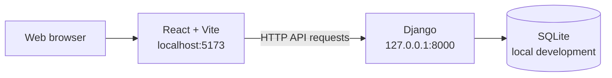

# Architecture

## Overview

bam-_boo_! is a full-stack web application with two independently run development services:

- A React frontend built and served by Vite.
- A Django backend that exposes HTTP endpoints and provides the Django admin site.

The frontend and backend are intentionally separated so that each can be developed, tested, and built with its own toolchain.

## Continuous integration

`.github/workflows/ci.yml` runs on pushes, pull requests, and manual dispatches. Independent Ubuntu jobs use Node 24 for the frontend and Python 3.14 for the backend, with npm and pip download caches keyed by their dependency files. The frontend job installs with `npm ci`, runs the existing Node tests, checks formatting and JavaScript/TypeScript lint, and builds the production bundle. The backend job installs pinned requirements, checks Django configuration and Black formatting, checks for missing migrations, and runs Django tests with an isolated test database created and migrated by the test runner. No database service or secrets are required. The workflow validates changes; deployment is not configured.

## Local Git hooks

`.githooks/pre-commit` is a shared Bash hook that runs the same validation commands as CI against the entire working tree before each commit. Developers enable it per clone with `git config --local core.hooksPath .githooks` after installing dependencies. It uses local frontend dependencies, loads an installed nvm Node 24 when the shell runtime is unavailable, and selects a native backend environment. WSL development uses a Linux virtual environment at `backend/.venv`; the hook uses its `bin/python` interpreter. `BACKEND_PYTHON` overrides interpreter selection. Checks stop on the first failure and do not modify or stage source files. `.gitattributes` keeps hook scripts on LF line endings for Bash compatibility across platforms. GitHub Actions remains the validation gate for pull requests.

## System boundary



During local development, Vite serves the frontend and Django runs the backend separately. Vite proxies `/api/` and `/media/` requests to `http://127.0.0.1:8000`, so the browser uses same-origin URLs for JSON, transcripts, and recorded MP3 audio. Django also allows the Vite development origin through `CORS_ALLOWED_ORIGINS`.

## Repository structure

```text
.githooks/
	pre-commit       Local frontend and backend validation before commits

.github/
	workflows/ci.yml  GitHub Actions frontend and backend validation
	CODEOWNERS       Ownership rules for frontend, backend, docs, and repository configuration
	pull_request_template.md  Default PR description with changes, screenshots, testing, setup notes, and future work

backend/
	challenges/       SQLite-backed challenges, tree validation, JSON API, imports, admin upload, production validation
	users/            User profiles and progress API
	media/challenges/ Imported challenge packages grouped by slug (local, not committed)
	challenges/source_data/challenges/  Authored local challenge packages and manifests
	counter/
		models.py       Persisted shared bam/boo count
		views.py        JSON read and update endpoints
		migrations/     Database schema migrations
	config/
		settings.py     Django settings, middleware, CORS, and database configuration
		urls.py         Root, health, and admin routes
		asgi.py         ASGI entry point
		wsgi.py         WSGI entry point
	manage.py         Django command-line entry point
	requirements.txt  Python dependencies
	pyproject.toml    Black formatter configuration
	db.sqlite3        Local database created by migrations (not committed)

data/
	sample-scenario.json  Legacy prototype fixture; no longer imported by the frontend

frontend/
	src/
		main.tsx        React application entry point
		App.tsx         Top-level training flow and page navigation
		pages/          Home, challenge, results, authentication, and profile pages
		components/     Shared interface components and icons
		challenges.ts   Challenge API client and transcript hydration
		auth.ts         Session authentication and profile API client
		conversation.ts Branch traversal and answer matching
		routes.ts       Routes derived from the loaded challenge date
		types.ts        Shared frontend flow types
	    index.css       Tailwind CSS import and global styles
			assets/         Frontend image and SVG assets
	tests/            API-loading and conversation tests using native TypeScript support
	package.json      npm scripts and dependencies
	prettier.config.ts Prettier and Tailwind class-sorting configuration
	.prettierignore   Prettier exclusions
	tsconfig*.json    TypeScript configuration for app and build tooling
	vite.config.ts    Vite and Tailwind configuration

docs/
	ARCHITECTURE.md   Current system design and ownership boundaries
	SETUP.md          Local installation and run instructions
	CONTRIBUTING.md   Contribution and commit guidance
	CHALLENGES.md     Local challenge package layout and authoring/import workflow
```

## Frontend

The frontend is written in TypeScript. Its entry point is `frontend/src/main.tsx`; it mounts the root `App` component into the page and loads `frontend/src/index.css`. Training content comes from the Django challenge API and SQLite. `challenges.ts` loads the challenge list, selects the `forgot-password-x3` demo when present (otherwise the first challenge), fetches its detail, and loads the referenced transcripts in parallel. Media URLs resolve from the origin root so direct visits to nested challenge routes work. Loading, retry, empty-database, and missing-transcript states use a compact inline notice while the frontend layout remains visible; there is no static-scenario fallback. Without challenge data, the home page shows the current local month, placeholder statistics, disabled calendar actions, and an empty recording card. Retrying failed requests restores real challenge/account data without reloading the page. The interface is styled with Tailwind CSS utility classes in React components; `frontend/src/index.css` imports Tailwind and contains only global CSS rules.

Use npm scripts from the `frontend` directory:

- `npm run dev`: start the Vite development server on port `5173`.
- `npm test`: run the API-loading, branch-traversal, and answer-matching tests with Node 24’s built-in test runner and TypeScript support.
- `npm run build`: type-check the frontend and create a production build in `frontend/dist`.
- `npm run lint`: check frontend formatting with Prettier.
- `npm run lint:js`: lint JavaScript and TypeScript with Oxlint.
- `npm run format`: apply Prettier formatting and Tailwind class sorting.
- `npm run preview`: preview the production build locally.

Tailwind CSS is integrated through `@tailwindcss/vite` in `frontend/vite.config.ts`. Add UI styling with Tailwind utility classes rather than introducing component-specific CSS files unless a custom CSS rule is necessary.

Frontend build tooling uses `@types/node` for the Node.js APIs in Vite configuration.

Python formatting is enforced with Black using `backend/pyproject.toml`. Frontend formatting is enforced with Prettier and `prettier-plugin-tailwindcss`; Oxlint remains available as `npm run lint:js` for TypeScript and JavaScript quality checks.

The frontend uses browser history for its routes: `/` renders the calendar, `/challenges/:date` renders the assigned challenge, and `/challenges/:date/complete` renders that challenge's results. The challenge date comes from the loaded challenge. Result feedback is retained in session storage with its numeric challenge ID, per-completion submission token, and original completion timestamp to support a results-page reload during the same browser session.

`/login` and `/signup` render `AuthPage.tsx`; `/profile` renders `ProfilePage.tsx` for the signed-in user and the login form while the account is anonymous or unknown. Signed-in visitors to either authentication route see their profile. Account pages resolve independently of challenge loading, including when the database has no challenges or media is unavailable. `App.tsx` restores the account through `/api/users/auth/me/` on mount; session loading and connection failures keep the form visible with a small status notice and retry action. Authentication submission waits for the initial session check to finish, and fields remain editable. A failed session check permits a later login attempt. The home header links to login or the current user's profile instead of displaying a placeholder avatar and streak. Recordings remain available without signing in.

`auth.ts` owns same-origin, cookie-based authentication requests and typed account/profile responses. Before each signup, login, logout, or score POST it fetches a fresh CSRF token, so token rotation after login or a change in another tab does not leave a cached token. Credentials, session identifiers, and CSRF tokens are not written to browser storage. Authentication errors and Django signup validation messages appear in the form; pending submissions disable inputs and the submit button. Requests made by page effects and sign-in forms are cancelled on unmount. Signup checks password confirmation before submitting and starts a session through the existing API.

The profile displays the current account's username and email plus its stored avatar, total score, completed challenge count, and per-challenge scores from `/api/users/<id>/profile/`. Profile loading and logout failures have separate error states; profile reads can be retried and a failed logout retains the signed-in account. Successful logout clears the frontend account and locally retained challenge result, then opens login. Profile fields are read-only in the interface, while challenge completion automatically saves scores through the authenticated current-user score endpoint. Results retain their completing account's ID (or `null` for a guest), a unique submission token, and the original completion timestamp alongside feedback in browser session storage. The results page shows saving, saved, and retryable failure states; a session expiry prompts login again. A guest can sign in or sign up to claim their pending result, but a result already assigned to one account is not submitted for another. Saving continues when navigating from results to the calendar or profile, and the profile reloads progress when a save finishes. Starting a retry keeps the previous result until another completion or logout, so beginning an attempt does not cancel an in-flight save. Reloading a retained result reuses its submission token and completion time, so retrying a save does not duplicate attempt history. A newly completed replay receives a new token and is always recorded, even when its score is lower. The profile displays only best scores, while Django admin exposes every attempt with its completion and receipt timestamps. Results saved before completion timestamps were introduced are display-only and require replay to create an attempt; the app does not invent historical completion times. API-client and route tests cover session restoration, authentication requests, fresh CSRF tokens, validation failures, HTML errors, cancellation, profile reads, and account routing without challenge data. Offline-layout regression tests bundle the app in memory with Vite and render it using React's server renderer to check that the calendar and authentication forms render without waiting for backend requests; these checks add no dependencies and do not start a server.

The challenge has tone, conversation, and next-action stages. Conversation history starts at the tree root (a customer/question node). Selecting an agent/response child appends that response and its recorded customer follow-up, then exposes only that follow-up’s available replies. The bundled demo has three paths with two agent turns each and one customer continuation per agent node. Reaching a leaf unlocks the next-action stage. Both speakers have native MP3 controls and visible transcripts; selected agent audio plays before the customer follow-up, subject to browser autoplay permissions. Tone and action feedback use whole-word matching against the loaded challenge’s `tone` and `required_action` values.

Vite enables polling for file watching so source changes in mounted Windows workspaces invalidate its transformed-module cache. Restart Vite once after changing this configuration. The Vite development proxy supplies both API and media access. Production hosting must also route `/api/` to Django and `/media/` to the stored recordings; Django’s development media serving is not a production media server.

## Backend

The Django project is configured in `backend/config`:

- `settings.py` enables Django’s built-in apps, `django-cors-headers`, and SQLite.
- `counter/` owns the shared count model and its JSON API.
- `challenges/` owns dated challenges, their alternating question/response JSON trees, API serialization, package validation/installation, the `import_challenges` and `validate_challenges` commands, the compatibility `seed_kale_demo` command, and the staff-only admin ZIP import. Package loading lives in `challenges/package.py`, FFprobe checks in `challenges/audio.py`, serialization in `challenges/serialization.py`, and production-readiness checks in `challenges/validation.py`. The CLI reads `backend/challenges/source_data/challenges/<slug>/`, while the admin upload extracts and validates a ZIP in a temporary directory before installing. The admin import is disabled as a normal add form because a valid challenge requires a complete media package, and imported challenge fields are read-only so changes go through Replace and keep source and media synchronized. Each challenge has a unique, stable slug, a unique name, and its existing numeric database ID. Changing the name or schedule date does not change the slug. SQLite stores metadata and per-turn filenames; UTF-8 transcripts and MP3s remain local files. Authored packages live in `backend/challenges/source_data/challenges/<slug>/`, with `<slug>.json`, flat `audio/`, and flat `transcripts/` folders. The folder name must match the challenge slug. The importer validates selected packages and stages each complete package under both `backend/media/challenges/<slug>/` and `backend/challenges/source_data/challenges/<slug>/`; CLI imports skip the source copy because the package already lives there. Replacement preserves database IDs and restores old files if saving fails. Every imported MP3 must pass `ffprobe` with an MP3 audio stream and positive duration. See [CHALLENGES.md](CHALLENGES.md) for the manifest and publishing workflow.
- `tone/` owns ConceptNet Numberbatch word embeddings stored as word/vector rows in SQLite. The `load_vectors` management command reads a compressed vector file from `data/numberbatch-en-19.08.txt.gz` or a `--file` path, downloading it if missing. It skips downloading and loading when any vectors already exist unless `--clear` is supplied to replace them. Its tone-similarity endpoint is scaffolded but not implemented; frontend tone grading uses whole-word matching.
- `users/` owns user profiles, progress endpoints, and session authentication. `forms.py` extends Django's `UserCreationForm` to validate signup credentials, optional email, and an optional existing group; `views.py` uses Django's `authenticate`, `login`, and `logout` functions with the existing database session backend.
- `urls.py` currently defines the following routes:
  - `/`: backend service status JSON.
  - `/api/health/`: health status JSON.
  - `/api/count/`: `GET` the saved count or `POST` a `delta` of `1` or `-1`.
  - `/api/challenges/`: list saved challenges with numeric `id`, unique `slug`, and display name; optionally filter by category. Fuzzy name matching with strict date/difficulty filters is scaffolded but commented out.
  - `/api/challenges/<id>/`: challenge detail, required action, and the full conversation tree with transcript/audio URLs.
  - `/api/challenges/<slug>/`: scaffolded challenge detail by slug; returns `501` until implemented.
  - `/api/users/<id>/profile/`: existing user profile endpoint.
  - `/api/users/<username>/`: scaffolded `GET`/`POST` user read and update endpoint; returns `501` until implemented.
  - `/api/users/leaderboard/`: top ten users by total score.
  - `/api/users/groups/`: public `GET` of existing group IDs and names for signup, ordered by name.
  - `/api/users/me/scores/<challenge_id>/`: authenticated `POST` of completion metrics, a submission token, and a completion timestamp; records an attempt for the numeric challenge ID and updates the current user's best-score summary.
  - `/api/users/auth/csrf/`: `GET` a CSRF token and set the CSRF cookie.
  - `/api/users/auth/signup/`: `POST` signup credentials, create an account/profile, and start a session.
  - `/api/users/auth/login/`: `POST` credentials and start a session.
  - `/api/users/auth/logout/`: `POST` to flush the session.
  - `/api/users/auth/me/`: `GET` the current account, or `401` when anonymous.
  - `/api/tone/<tone1>&<tone2>/`: scaffolded tone-similarity endpoint; returns `501` until implemented.
  - `/media/`: local development transcript and MP3 serving when `DEBUG` is enabled.
  - `/admin/`: Django admin.
  - `/admin/challenges/challenge/import-package/`: staff-only ZIP challenge import.
- `manage.py validate_challenges` is the production-readiness check for challenge rows, source packages, media files, and generated URLs. It reports errors only and exits non-zero on failure.
- `manage.py` is the entry point for checks, migrations, and the development server.

Backend dependencies are pinned in `backend/requirements.txt`. Run Django commands through the repository virtual environment.

### Session authentication API

Authentication uses Django's built-in `User`, its hashed passwords, and the existing one-to-one `UserProfile`. The existing signal creates the profile on signup. Session authentication adds no dependencies. The optional profile group uses the migration described below. Profile and leaderboard reads retain their existing public behavior.

`users/management/commands/seed_local_superuser.py` creates a shared local-development superuser through Django's `create_superuser` after migrations during the documented setup. Every fresh clone uses username `admin`, password `teamkale`, and email `admin@example.test`; Django hashes the password and the existing user signal creates its profile. The command requires `DEBUG=True`, preserves existing active superusers without resetting credentials or progress, and rejects a conflicting regular or inactive account. Account creation and profile creation share a transaction. The account is seeded explicitly during setup; application startup and migrations do not create it. See [SETUP.md](SETUP.md) for usage and credentials.

Use same-origin `/api/` URLs through the Vite proxy. `CSRF_TRUSTED_ORIGINS` permits `http://localhost:5173` because proxied browser requests retain that Origin header. Direct cross-origin frontend requests to port 8000 are not the supported browser flow.

| Method | Path | Request | Success |
| --- | --- | --- | --- |
| GET | `/api/users/groups/` | None | `200`, `{"groups": [{"id": 3, "name": "Team Kale"}]}`; an empty list when no groups exist |
| GET | `/api/users/auth/csrf/` | None | `200`, `{"csrfToken": "..."}` and a `csrftoken` cookie |
| POST | `/api/users/auth/signup/` | JSON `username`, `password`, optional `email` and `group_id` | `201`, account and CSRF token; sets session cookie |
| POST | `/api/users/auth/login/` | JSON `username`, `password` | `200`, account and CSRF token; sets session cookie |
| POST | `/api/users/auth/logout/` | No body required | `200`, `{"detail": "Logged out."}`; clears session, including for an already anonymous client |
| GET | `/api/users/auth/me/` | None | `200`, account and CSRF token |

Account responses have the shape `{"user": {"id": 7, "username": "ada", "email": "ada@example.com"}, "csrfToken": "..."}`. Passwords and permissions are never included. All authentication responses disable caching. Signup accepts username, password, optional email, and an optional existing group; additional properties cannot grant privileges. Email is optional and is not a unique account identifier; login uses username. Signup applies Django's username, email, duplicate-username, configured password validation, and group existence validation. It returns `400` with `{"errors": {"field": ["message"]}}` for form validation failures. Malformed JSON, non-object bodies, missing credentials, non-string credential fields, or a content type other than `application/json` return `400` with `{"detail": "..."}`. Invalid credentials and inactive accounts return the same generic `401` response. Anonymous `/me/` requests return `401`. Unsupported HTTP methods return `405`.

Every authentication POST, including anonymous signup/login/logout, requires the CSRF cookie and an `X-CSRFToken` header. Missing or invalid tokens and untrusted origins return Django's standard `403` response, which may be HTML. Fetch `/csrf/` before the first POST. Successful signup/login rotates the CSRF secret, so replace your saved token with the returned `csrfToken` before the next POST. Cookies identify the session on later requests; `/me/` lets the frontend restore its signed-in state after reload. Authentication does not automatically record dates in `UserProfile.login_days`.

`UserProfile.group` is an optional foreign key to Django's existing `auth.Group` table, stored as `group_id`. One group can have many profiles through `Group.profiles`; deleting a group sets the profile association to null without deleting the user. Signup accepts a positive integer `group_id` (or null/omission for no group), verifies that it exists, and saves the profile association in the account-creation transaction. Invalid types, non-positive IDs, and nonexistent groups return `400`. The signup page loads `/api/users/groups/` and renders an optional selector, with loading, empty, and retryable failure states. The list endpoint returns only IDs and names, never permissions.

The profile association groups user records but does not add a user to the separate `User.groups` permission-membership relation or grant privileges. Django's permission memberships remain administrator-controlled. Account, profile, and leaderboard response schemas remain unchanged, and group values are not displayed anywhere else in the frontend. Django admin exposes the profile association in user/profile forms and provides filtering by group. Create selectable groups under **Authentication and Authorization → Groups**.

Migration `users/0004_userprofile_group.py` introduced the earlier text label. `users/0005_alter_userprofile_group.py` safely converts saved labels into group records, reuses groups with matching names, links profiles to them, and converts empty labels to null. It preserves scores, account records, and existing permission memberships. Reversing this migration restores group names as text without deleting group records.

Example browser flow (with Vite and Django running):

```javascript
let { csrfToken } = await fetch('/api/users/auth/csrf/').then((r) => r.json())

const response = await fetch('/api/users/auth/signup/', {
  method: 'POST',
  credentials: 'same-origin',
  headers: {
    'Content-Type': 'application/json',
    'X-CSRFToken': csrfToken,
  },
  body: JSON.stringify({
    username: 'ada',
    password: 'River!Quartz7Maple',
    email: 'ada@example.com',
  }),
})
const result = await response.json()
if (!response.ok) throw new Error(JSON.stringify(result))
csrfToken = result.csrfToken

// Login uses the same POST shape without email, at /api/users/auth/login/.
const currentAccount = await fetch('/api/users/auth/me/').then((r) => r.json())

await fetch('/api/users/auth/logout/', {
  method: 'POST',
  credentials: 'same-origin',
  headers: { 'X-CSRFToken': csrfToken },
})
```

See Django's [authentication documentation](https://docs.djangoproject.com/en/6.1/topics/auth/default/) and [AJAX CSRF guidance](https://docs.djangoproject.com/en/6.1/howto/csrf/) for the underlying session and token behavior.


### Challenge score saving API

`POST /api/users/me/scores/<challenge_id>/` uses the existing **numeric challenge ID**. It requires an authenticated Django session, the CSRF cookie, and an `X-CSRFToken` header. The frontend's `saveChallengeResult` uses the same fresh-token request helper as signup/login/logout. The JSON body contains:

```json
{
  "tone_correct": true,
  "tone_time": 8,
  "action_correct": true,
  "attempt_id": "627e5d91-c343-44ae-b6ab-532b2ed41b8e",
  "completed_at": "2026-10-29T01:23:45.000Z"
}
```

`tone_correct` and `action_correct` must be booleans. `tone_time` must be a finite, non-negative number of seconds. `completed_at` is a timezone-aware ISO timestamp captured when the frontend finishes the challenge, before any later guest login or network retry. `attempt_id` is a unique per-completion submission token (UUID-formatted text), generated once and retained with the result. It identifies the submission, not the challenge. Challenges keep their existing numeric primary keys and have no new UUID field.

The server calculates one star for each correct answer and one for identifying the tone within 10 seconds, matching the results screen. Each attempt is scored as an integer from 0 to 3, and the profile total is the sum of each challenge's best star score. Completion metrics and completion time are reported by the prototype client; the endpoint validates them and calculates points but does not independently grade the answers or verify elapsed time.

`users.models.ChallengeAttempt` stores every distinct completion with an automatic numeric primary key, a unique text `submission_id`, foreign keys to the user's profile and the existing numeric challenge ID, the computed `score`, the original `completed_at`, and a server-generated `received_at`. Django stores aware timestamps in UTC. A lower or equal score from a new completion still creates a new attempt. Reusing a submission token with the same user, challenge, score, and completion time returns the existing attempt; reusing it for different data returns `409` without changing scores. Django admin's **Users → Challenge attempts** lists all attempts and timestamps as read-only records.

Within a transaction, the endpoint selects the profile using `request.user`, creates or retrieves the attempt, and maintains `UserProfile.scores` as a best-score summary keyed by the numeric challenge ID converted to a string. `total_score` sums those best scores. Profile reads, completed-challenge counts, and the leaderboard use that summary, so the frontend displays only the best score for each challenge. A zero-point completion still counts as a completed challenge. Extra client properties cannot target another profile or override the computed score.

Success returns `201` for a new completion or `200` for a repeated save of the same completion. It includes the best-score profile fields plus the recorded attempt:

```json
{
  "user_id": 7,
  "username": "ada",
  "avatar": "fox",
  "total_score": 3,
  "completed_challenges": 1,
  "scores": {"42": 3},
  "attempt": {
    "id": 3,
    "attempt_id": "627e5d91-c343-44ae-b6ab-532b2ed41b8e",
    "challenge_id": 42,
    "score": 2,
    "completed_at": "2026-10-29T01:23:45+00:00",
    "received_at": "2026-10-29T01:24:00+00:00"
  }
}
```

Malformed JSON, missing/invalid fields, invalid submission tokens, timezone-naive timestamps, and content types other than `application/json` return `400` with a `detail` message. Anonymous requests with valid CSRF return `401`; missing numeric challenge IDs return JSON `404`. CSRF or origin failures return Django's standard `403`, which may be HTML. Unsupported methods return `405`. Responses disable caching. The username read/update placeholder remains unimplemented and is not used for score writes.

Migration `users/0003_challengeattempt.py` creates attempt storage. Migration `users/0006_score_points.py` converts existing percentage-based best scores and attempts to the corresponding whole-star score from 0 to 3 and changes stored totals to integer points. Apply migrations with `manage.py migrate`. Earlier attempt histories and completion times cannot be reconstructed. No new dependencies are required. Tests cover all-attempt persistence, numeric challenge linkage, original completion times, retry deduplication, best-score summaries, user isolation, validation, authentication, CSRF, and frontend save states.

## Data and persistence

Local development uses SQLite at `backend/db.sqlite3`. Django migrations are the source of truth for schema changes. Do not edit the database file directly or commit it to the repository. After migrations, run `backend/.venv/bin/python backend/manage.py import_challenges` to load all authored local packages. Pass challenge slugs to select packages, and `--replace` to update existing ones without deleting their database rows. Imports preserve existing numeric IDs. The Django admin import accepts one ZIP package at a time, uses the same validation and installation path, writes the source package alongside the published media, and writes audit entries to Django admin history. Import limits are configured in `backend/config/settings.py`. `seed_kale_demo` remains a shortcut for the bundled demo; `--force` delegates to replacement. Generated media is excluded from Git. Back up `backend/db.sqlite3`, `backend/media/challenges/`, and `backend/challenges/source_data/challenges/` before imports. `validate_challenges` is the read-only production gate; it requires every database challenge to have a matching source package and byte-identical published media.

When models are introduced or changed:

1. Add or update the Django model.
2. Generate a migration with `manage.py makemigrations`.
3. Apply migrations with `manage.py migrate`.
4. Include the migration files in the change.

## Request flow

1. A user opens the Vite-served React application in a browser.
2. React renders the current application route.
3. Frontend features call Django HTTP endpoints under the backend origin.
4. Django URL routing dispatches requests to views or installed Django applications.
5. Backend code reads or writes SQLite through Django’s ORM when persistence is required.
6. Django returns JSON or an appropriate HTTP response to the frontend.

## Architectural conventions

- Keep UI rendering and browser interaction in `frontend/`.
- Keep API routing, validation, business logic, persistence, and administration in `backend/`.
- Prefer explicit API boundaries over sharing implementation details between frontend and backend.
- Add frontend dependencies to `frontend/package.json` and backend dependencies to `backend/requirements.txt`.
- Keep local-only files such as virtual environments, SQLite databases, `node_modules`, and build output out of version control.

## Keeping this document current

Update this document in the same change whenever a structural decision changes. In particular, update it when:

- A new Django app, API boundary, database model, or persistence technology is added.
- Frontend routing, state management, API client structure, or build behavior changes.
- A service, port, environment variable, or external dependency is added.
- A directory moves or a new top-level project area is introduced.

Architecture changes should be called out in pull requests and reflected in the relevant setup or contribution documentation.

Frontend tests import `challenges.ts` and `conversation.ts` directly with Node 24. API tests mock browser globals and fetch responses; conversation tests exercise branch traversal and answer matching. They need no running Django or Vite server, filesystem watcher, or native bundler. The frontend build validates Vite integration separately. Windows users run development commands and commits from WSL using the same Linux environment.

The pre-commit hook checks platform-specific local npm launchers for Prettier, Oxlint, TypeScript, and Vite before running frontend checks. Missing launchers require reinstalling development dependencies in the committing terminal; the hook does not download dependencies automatically.
