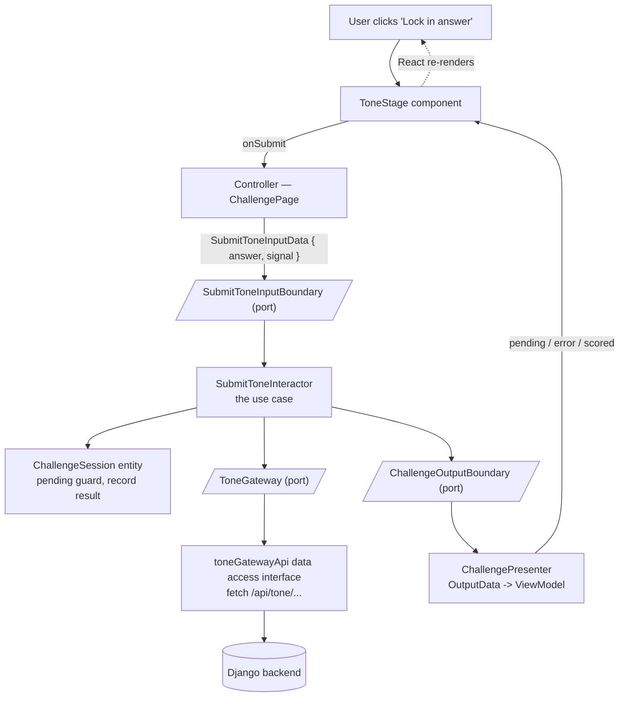

# Clean Architecture Migration Plan — Challenge Flow

**Status:** Proposed · **Scope:** frontend only · **New dependencies:** none · **Backend changes:** none

---

## 1. Executive Summary

The challenge experience — the product's core surface — lives in one 374-line React component that mixes business rules, API orchestration, and UI rendering. The most valuable logic is therefore the hardest to test and change.

This migration reorganizes the flow into Clean Architecture (Martin, *Clean Architecture*, Ch. 22) — Entities, Use Cases, Ports, and Adapters/Presenters/View — enforcing one rule: **dependencies point inward only**. Business logic becomes framework-free and unit-testable; React becomes a replaceable outer shell.

**Outcomes:** full unit testability of the challenge flow · change isolation between UI and rules · zero behavior change · zero new dependencies · six independently validated phases.

---

## 2. Problem

| Module | Issue |
|---|---|
| `pages/ChallengePage.tsx` (374 lines) | 12 state hooks, 3-stage state machine, scoring, matching, async orchestration, and all UI inline |
| `challenges.ts` | HTTP adapter and date formatting mixed in one module |
| `conversation.ts` | Pure domain logic, but in the wrong layer |
| `tone.ts` | Pure API adapter, but not behind an interface |

Consequences: business rules are untestable in isolation, UI refactors risk regressing logic, and the folder structure doesn't describe what the app does.

## 3. Goals / Non-Goals

**Goals:** separate the flow into Clean Architecture layers · make every rule unit-testable with the existing Node runner · preserve 100% of user-facing behavior · introduce zero dependencies.

**Non-goals:** no UI redesign · no changes to `auth.ts`, `routes.ts`, `types.ts` · no state-management libraries · no backend or API changes.

## 4. Target Architecture



Every user action follows this same circuit. The dashed shapes are interfaces — the seams where the stable inner code (use case + entity) talks to the changeable outer world (React, HTTP) without knowing anything about it.

### What this accomplishes

- **The use case is the brain.** All decisions (guard against double-submit, measure elapsed time, handle abort, present results) live in the interactor — no React, no fetch, just logic.
- **The entity is the memory.** All session state lives in `ChallengeSession`; the four use cases share it and nothing else mutates it.
- **The boundaries are the contract.** The interactor only knows `ToneGateway` and `ChallengeOutputBoundary`. Swap the Django call for a mock in tests, or a different backend later — the interactor never changes.
- **The presenter is the translator.** It converts generic output data into the exact shape the screen needs (options list, step %, labels).
- **The view is dumb.** Components receive a ViewModel and render it; deleting or restyling them cannot break business rules.

### Layers

| Layer | Directory | Responsibility | May depend on |
|---|---|---|---|
| Entities | `src/entities/` | Pure business rules: traversal, matching, session state machine | nothing |
| Use Cases | `src/useCases/` | One interactor per use case; orchestration | entities, boundaries |
| Ports | `src/boundaries/` | Interfaces + data-transfer objects (boundaries) | entities |
| Adapters | `src/dataAccessInterface/` | HTTP, clock, ID implementations of boundaries | boundaries, entities |
| Presenter | `src/presenters/` | OutputData → ViewModel formatting | boundaries, entities |
| View/Controller | `src/pages/`, `src/components/` | React rendering + event wiring | everything inward |

### The four use cases

| Use case | Owns (current code) |
|---|---|
| **StartChallenge** — fetch data, build session | `loadChallenge` + session init |
| **SubmitTone** — grade the customer's tone | `ChallengePage.tsx:69-97` |
| **AdvanceConversation** — reply selection/traversal | `respond()`, `responseOptions()`, audio chaining |
| **CompleteChallenge** — finalize the result | `ChallengePage.tsx:99-108` |

Shared state lives in the **`ChallengeSession` entity**, passed to all four interactors. The page holds no challenge state; each use case mutates the entity and presents a snapshot.

## 5. Boundaries (condensed)

```ts
interface StartChallengeInputBoundary { execute(i: { date: string; signal: AbortSignal }): Promise<void> }
interface SubmitToneInputBoundary     { execute(i: { answer: string; signal: AbortSignal }): Promise<void> }
interface AdvanceConversationInputBoundary {
  selectResponse(i): void; sendResponse(): void; continueToAction(): void; audioEnded(i): void
}
interface CompleteChallengeInputBoundary { execute(): void }

interface ChallengeOutputBoundary { present(o: ChallengeOutputData): void }

type ChallengeOutputData =
  | { status: 'loading' } | { status: 'error'; message: string }
  | { status: 'ready'; session: SessionOutput }
  | { status: 'complete'; session: SessionOutput; result: ResultData }

interface ToneGateway     { score(answer, slug, signal): Promise<boolean> }
interface ChallengeGateway {
  loadSummaries(signal): Promise<ChallengeSummary[]>
  loadDetail(slug, signal): Promise<Challenge>
}
interface Clock { now(): number }
interface IdGenerator { randomId(): string }
```

`Clock` and `IdGenerator` make time and UUID generation injectable, so every use case is deterministic under test.

## 6. App-Level Loading Changes

`App.tsx` currently fetches the full challenge on mount for three pages. Because **StartChallenge** now owns the fetch:

1. App loads **summaries** (list) on mount — the home calendar needs only name/date.
2. `startChallenge` navigates using the summary's date; detail is fetched on entry.
3. `ChallengePage` receives a `date` prop and hosts StartChallenge.
4. `onComplete(result, challenge)` passes the loaded challenge back for the results view.
5. ResultsPage also hosts StartChallenge for direct URL reloads (behavior preserved).
6. HomePage prop type narrows `Challenge` → `ChallengeSummary` (render unchanged).

Intentional impact: home loads a lighter payload; challenge-detail errors/retry move from the global notice into the owning pages.

## 7. File Change Ledger

| Action | File |
|---|---|
| Move | `src/conversation.ts` → `src/entities/conversationRules.ts` |
| Move | `src/tone.ts` → `src/dataAccessInterface/toneGatewayApi.ts` |
| Split | `src/challenges.ts` → `src/dataAccessInterface/challengeGatewayApi.ts` + `src/presenters/challengeDatePresenter.ts` |
| New | `src/entities/challengeSession.ts` (ChallengeSession, normalizeToneInput, buildResult) |
| New | `src/boundaries/{challengeOutputBoundary.ts,dataAccessInterfaces.ts}` |
| New | `src/useCases/{startChallenge,submitTone,advanceConversation,completeChallenge}/ — one interactor plus its input boundary per folder` |
| New | `src/dataAccessInterface/browserServices.ts` (Clock/IdGenerator/scroll) |
| New | `src/presenters/ChallengePresenter.ts` (+ `src/pages/useChallengeFlow.ts` composition hook) |
| New | `src/components/challenge/` — styles, ChallengeHeader, ChallengeLoading, ToneStage, ConversationHistory, ResponseStage, ActionStage |
| Rewrite | `src/pages/ChallengePage.tsx` (controller, ~120 lines), `src/App.tsx` (§6), `src/pages/ResultsPage.tsx` (loading wrapper) |
| Edit (imports) | `src/pages/HomePage.tsx`, `src/pages/ProfilePage.tsx` |
| New tests | `start-challenge`, `submit-tone`, `advance-conversation`, `complete-challenge`, `entities-challenge` (`.test.mjs`) |
| Edit tests (imports) | `challenges`, `conversation`, `tone` (`.test.mjs`) |
| Docs | `docs/ARCHITECTURE.md` |

## 8. Testing Strategy

Each interactor is tested with fake gateways, fake clock/IDs, and a recording presenter — the Ch. 22 pattern. Coverage: load/error/abort sequences, double-submit guard, elapsed-time math, branch validation, stage gating, audio chaining, result shape. The existing three test files pass with import-path changes only, proving behavioral equivalence.

## 9. Risks & Mitigations

| Risk | Mitigation |
|---|---|
| Behavioral regression during extraction | Phase 1 moves files only; suite must pass with zero logic changes first |
| Over-engineering a single page | No new frameworks; every abstraction is load-bearing (testability, injection) |
| App loading rework breaks other pages | Six isolated changes; covered by existing tests + manual smoke |
| StrictMode/async edge cases | Pure use-case construction; abort handling ported verbatim |

## 10. Rollout Phases (each validated before the next)

1. Move/split modules; update imports + existing tests → **tests green, no logic change**
2. `entities/challengeSession.ts` + `boundaries/{challengeOutputBoundary.ts,dataAccessInterfaces.ts}` + entity tests
3. Four interactors + their tests
4. `browserServices.ts`, `ChallengePresenter`, `useChallengeFlow` hook
5. Extract `components/challenge/*`; rewrite `ChallengePage.tsx` as controller
6. App rework (§6), ResultsPage wrapper, HomePage type edit
7. Update `docs/ARCHITECTURE.md`

## 11. Validation

```bash
cd frontend && npm test && npm run build && npm run lint && npm run lint:js
```

## 12. References

- Martin, "The Clean Architecture" (2012): https://blog.cleancoder.com/uncle-bob/2012/08/13/the-clean-architecture.html
- Martin, *Clean Architecture* (2017), Ch. 22 "The Dependency Rule": https://www.informit.com/articles/article.aspx?p=2832399
- Growin, "Using a Clean Architecture with React" (worked example): https://www.growin.com/how-to-use-a-clean-architecture-with-react
- `falsy/react-with-clean-architecture` (reference implementation): https://github.com/falsy/react-with-clean-architecture

---

## Appendix — Traceability

| Current code | New home |
|---|---|
| `ChallengePage.tsx` state hooks | `entities/challengeSession.ts` — ChallengeSession |
| `submitTone` (69-97) / `submitAction` (99-108) / `sendResponse` (110-115) | `interactors/{submitToneInteractor,completeChallengeInteractor,advanceConversationInteractor}.ts` |
| Style constants (18-24); header (122-147); tone stage (158-222); history (224-255); response stage (257-321); action stage (323-368) | `components/challenge/{styles,ChallengeHeader,ToneStage,ConversationHistory,ResponseStage,ActionStage}.tsx` |
| `challenges.ts` I/O / date helpers | `dataAccessInterface/challengeGatewayApi.ts` / `presenters/challengeDatePresenter.ts` |
| `conversation.ts`, `tone.ts` | `entities/conversationRules.ts`, `dataAccessInterface/toneGatewayApi.ts` (verbatim) |
