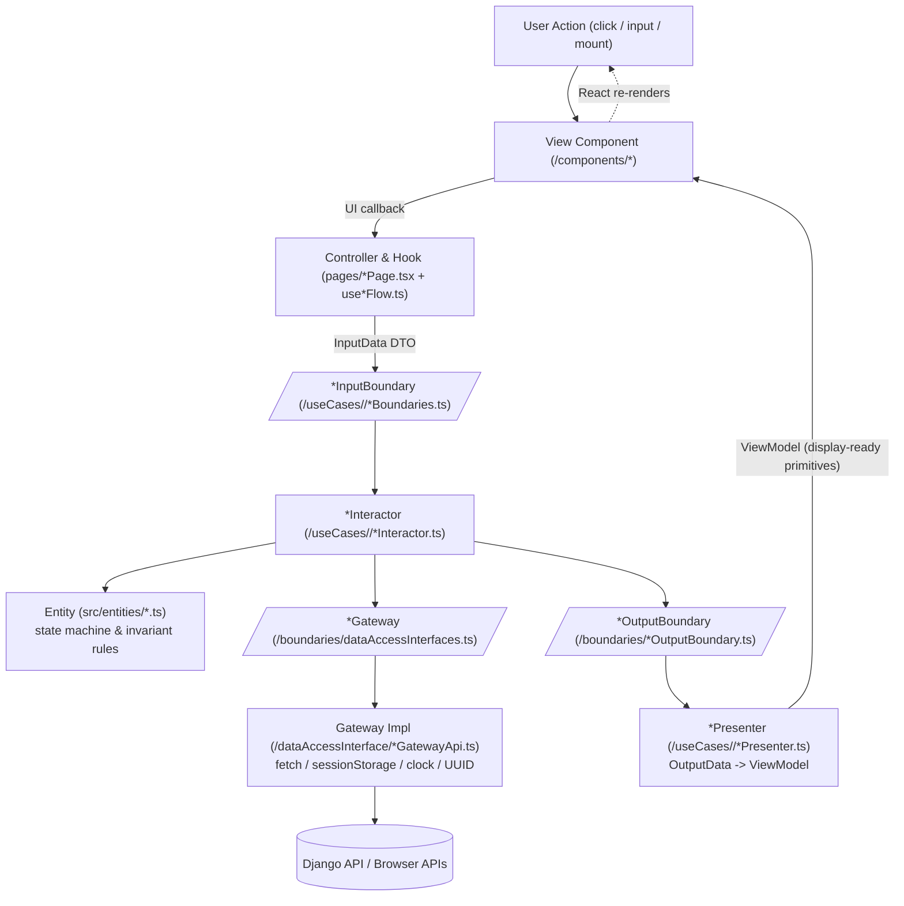

# Frontend Clean Architecture Migration Plan

**Status:** Complete (Phases A–E) · **Scope:** `frontend/src` · **New dependencies:** none · **Backend changes:** none

---

## 1. Executive Summary

`bam-boo`'s React pages originally grew as monolithic components (230–375 lines each) combining domain rules, network orchestration, browser state, and JSX markup in single files. This coupling made core product rules difficult to unit-test without a browser, fragile during UI edits, and costly to evolve.

This plan standardizes the entire frontend around **Clean Architecture** (Martin, *Clean Architecture*, Ch. 22) — **Entities**, **Use Cases**, **Boundaries**, **Data Access Interfaces / Presenters**, and **Views / Controllers** — governed by one rule: **source code dependencies point inward only**.

- **Pilot Validated (Phase A):** The **Challenge Flow** (`ChallengePage`, attempt snapshots, server-owned tone/action grading, challenge loading, and attempt resume) has been migrated as the reference slice, expanding the deterministic Node test suite with zero new dependencies and zero behavioral regressions.
- **Generalized Rollout (Phases B–E Complete):** The pilot's architecture, naming conventions, and lessons learned now cover **Results & Claim Persistence**, **Authentication**, **Profile**, and **Home / Calendar**. Results use `restoreChallengeResult` and `claimChallengeResult`, with the composition hook held by `App` so claims survive navigation.

---

## 2. Reference Architecture & Data Flow



### The Five Architectural Roles

1. **Use Case Interactor (Brain) — `src/<feature>/useCases/<useCase>/`:** Orchestrates a single user or system intent (e.g., `startChallenge`, `submitTone`, `authenticateUser`). Pure TypeScript — no React, no `fetch`, no DOM. Each use-case folder also owns its presenter, so output translation changes travel with the use case that emits it.
2. **Entity (Memory & Rules) — `src/entities/`:** Encapsulates domain state and business invariants shared by routes (e.g., conversation tree rules, stage transitions, score/star rules, credential validation). Domain types live alongside the entities in `src/entities/types.ts`.
3. **Boundaries (Contracts) — `src/<feature>/boundaries/` & `src/<feature>/useCases/<useCase>/*Boundaries.ts`:** Input boundaries (`*InputBoundary`), output boundaries (`*OutputBoundary`), DTOs, and driven gateway interfaces (`*Gateway`, `Clock`, `IdGenerator`).
4. **Data Access Interfaces & Presenters (Translators) — `src/<feature>/dataAccessInterface/`, `src/<feature>/useCases/<useCase>/`, & `src/<feature>/viewModels/`:** Concrete HTTP/storage/browser implementations of gateway interfaces, plus pure per-use-case presenters converting `OutputData` into screen-ready `ViewModel` primitives. Shared view-model mappers and formatters live in the feature's `viewModels/` folder; a formatter shared by multiple features can be promoted to `src/viewModels/`.
5. **View & Controller (Dumb Shell & Glue) — `src/<feature>/components/` & `src/pages/`:** Props-only React components agnostic of APIs/repositories, paired with a thin page controller (`*Page.tsx`) and composition hook (`use*Flow.ts`) in `src/pages/` that manage `AbortController` lifecycles and navigation.

---

## 3. Standardized Directory & Naming Conventions

Each product route has an application slice under `src/<feature>/` (for example `src/challenge/`) containing its `boundaries/`, `dataAccessInterface/`, `viewModels/`, `useCases/`, and route-specific `components/`. The enterprise layer stays in `src/entities/`, and page controllers stay in `src/pages/`, because they belong to different Clean Architecture layers. Shared shell code stays in `src/components/` and `src/routes.ts`; the shared JSON/CSRF client stays in `src/dataAccessInterface/`. `challenge/`, `results/`, `home/`, `profile/`, and `auth/` follow this layout.

| Layer | Directory | Naming Convention | Dependency Rule (May Import) |
|---|---|---|---|
| **Entities** | `src/entities/` | camelCase noun (`challengeSession.ts`, `userProfileProgress.ts`) + `types.ts` | Shared `types.ts` only |
| **Use Cases** | `src/<feature>/useCases/<useCase>/` | One folder per use case: `<useCase>Interactor.ts` + `<useCase>Boundaries.ts` + `<useCase>Presenter.ts`; feature-level shared store (e.g. `challenge/useCases/sessionStore.ts`) | `src/entities/`, `<feature>/boundaries/`, `types.ts` |
| **Shared Boundaries** | `src/<feature>/boundaries/` | camelCase (`challengeOutputBoundary.ts`, `dataAccessInterfaces.ts`) | `src/entities/`, `types.ts` |
| **Data Access** | `src/<feature>/dataAccessInterface/` | camelCase role (`challengeGatewayApi.ts`, `attemptGatewayApi.ts`, `attemptStorage.ts`, `browserServices.ts`) | `<feature>/boundaries/`, `src/entities/`, `types.ts`, shared `src/dataAccessInterface/` |
| **View Models / Presenters** | `src/<feature>/useCases/<useCase>/` + `src/<feature>/viewModels/` | `<useCase>Presenter.ts` (class) co-located with its use case; shared view-model mappers and formatters in `<feature>/viewModels/` | `<feature>/boundaries/`, `src/entities/`, `types.ts`, promoted `src/viewModels/` helpers |
| **Controllers & Views** | `src/pages/`, `src/<feature>/components/` | `*Page.tsx`, `use*Flow.ts`, PascalCase view components + `styles.ts` | All inward layers |

---

## 4. Key Lessons Learned from the Challenge Flow Pilot

These six lessons from Phase A govern all remaining frontend migrations:

| # | Lesson Learned | Standard Practice for Phases B–E |
|---|---|---|
| **1** | **Use-case-first folders beat monolithic page interactors.** A single 8-method interactor becomes a bottleneck; splitting by intent (`startChallenge/`, `submitTone/`, …) gives each file one reason to change (SRP) and makes each server transition independently testable. Results now render their retained completed snapshot instead of invoking the start use case and creating another run. | Create one folder per use case under `src/<feature>/useCases/<useCase>/` containing its `*Interactor.ts`, `*Boundaries.ts`, and `*Presenter.ts`. |
| **2** | **Share entities across interactors via a plain-TS `SessionStore`, not React refs.** Passing `useRef.current` getters or mutating `useState` objects inside `useMemo` triggers React Compiler / Oxlint (`react/refs`, `react/immutability`) warnings. | Use a lightweight closure store (`createSessionStore()`) in `src/<feature>/useCases/` when multiple interactors read/mutate the same active entity. |
| **3** | **Page-owned data loading decouples `app.tsx` (with seed handoff).** Moving detail fetching into a page's `Start*` use case localizes loading/error/retry UX. Passing an already-loaded entity as an optional seed avoids duplicate fetches on route transitions while keeping direct URL reloads self-sufficient. | Each page loads its own detail data via a `Start*` / `Load*` use case; pass in-memory seeds across immediate transitions where appropriate. |
| **4** | **All display formatting belongs in `Presenter.toViewModel()`.** Having view components call formatter helpers directly leaks presentation logic into JSX. | Derive all display strings (`dateLabel`), percentages (`progressPercent`), and flags (`conversationFinished`) inside the presenter so components are pure props-to-JSX templates. |
| **5** | **Node 24 native type-stripping has strict syntax rules.** `node --test` runs `.ts` files directly without bundling, which rejects TypeScript `constructor(private readonly x)` parameter properties and extensionless relative value imports. | Declare class fields explicitly in all classes; use `.ts` extensions on relative value imports (`allowImportingTsExtensions: true` in `tsconfig.app.json`). |
| **6** | **Atomic import updates prevent CI breakage.** Moving legacy modules (`challenges.ts`, `tone.ts`, `conversation.ts`) without committing updated page and test imports in the same commit breaks Vite bundling (`offline-layout.test.mjs`) and Node test resolution in CI. | Always stage file moves, consumer import updates, and test updates in the same commit; run the full 4-command validation gate before pushing. |

---

## 5. Frontend-Wide Migration Roadmap

| Phase | Surface & Current Bottleneck | Entities (`src/entities/`) | Use Cases (`src/<feature>/useCases/`) | Gateways (`src/<feature>/dataAccessInterface/`) | Presenter, Hook & Views |
|---|---|---|---|---|---|
| **Phase A** *(Complete)* | **Challenge Flow:** 374-line `ChallengePage.tsx`; mixed `challenges.ts`; now server-owned attempt snapshots | `challengeSession.ts` (attempt snapshot state) | `challenge/useCases/startChallenge/`, `challenge/useCases/submitTone/`, `challenge/useCases/advanceConversation/`, `challenge/useCases/completeChallenge/` | `challengeGatewayApi.ts`, `attemptGatewayApi.ts`, `attemptStorage.ts`, `browserServices.ts` | Per-use-case presenters + `challenge/viewModels/challengeViewModel.ts`, `challenge/useCases/sessionStore.ts`, `pages/ChallengePage.tsx`, `pages/useChallengeFlow.ts`, `challenge/components/*` (8 files) |
| **Phase B** *(Complete)* | **Results & Claim Persistence:** Result restore + claim saving + `sessionStorage` in `app.tsx`; achievement/status text inline in `resultsPage.tsx` | `challengeResultSummary.ts` (result validation, claim eligibility, server-graded outcomes) | `results/useCases/restoreChallengeResult/`, `results/useCases/claimChallengeResult/` | `resultClaimGatewayApi.ts`, `resultStorageService.ts` (`sessionStorage`) | Per-use-case presenters + `results/viewModels/resultsViewModel.ts`, `pages/useResultsFlow.ts` (composed by `App`), `pages/resultsPage.tsx`, `results/components/*` (summary, achievements, save status, actions) |
| **Phase C** *(Complete)* | **Authentication Flow:** 294-line `AuthPage.tsx` mixes password matching, group loading, and form UI; `auth.ts` mixes 4 concerns | `authCredentials.ts` (signup validation, password match, payload normalization) | `auth/useCases/restoreSession/`, `auth/useCases/authenticateUser/`, `auth/useCases/logoutUser/`, `auth/useCases/loadSignupGroups/` | `authGatewayApi.ts` (CSRF rotation + session endpoints) | Per-use-case presenters + `auth/viewModels/authViewModel.ts`, `pages/useAuthFlow.ts`, `auth/components/*` (login/signup form, group selector) |
| **Phase D** *(Complete)* | **Profile Flow:** 233-line `ProfilePage.tsx` manages parallel profile + summary fetches, logout state, and avatar lookup inline | `userProfileProgress.ts` (joins per-slug scores with challenge metadata) | `profile/useCases/loadUserProfile/` | `profileGatewayApi.ts` | Per-use-case presenters + `profile/viewModels/profileViewModel.ts`, `pages/useProfileFlow.ts`, `profile/components/*` |
| **Phase E** *(Complete)* | **Home & Calendar Flow:** 268-line `HomePage.tsx` computes calendar grid math inline and holds mock leaderboard/score constants | `dailyChallenge.ts` (summary selection), `trainingCalendar.ts` (month grid, weekday alignment, day states, `computeStreak`) | `home/useCases/loadTodayChallenge/`, `home/useCases/loadCalendar/`, `home/useCases/loadLeaderboard/` | `profileGatewayApi.ts`, `leaderboardGatewayApi.ts` | Per-use-case presenters + `home/viewModels/homeViewModel.ts`, `pages/useHomeFlow.ts`, `home/components/*` (daily card, calendar grid, leaderboard) |

### Phase B Use-Case Split (SRP)

| Use case | Single responsibility | Notes |
|---|---|---|
| `restoreChallengeResult` | Resolve, validate, and persist the completed result for display | Uses an optional in-memory completion seed, then falls back to `ResultStorage`. Checks the route slug and clears malformed storage. |
| `claimChallengeResult` | Attach a completed attempt to the signed-in account | Uses `challengeResultSummary.ts` for eligibility. Skips guests, already-saved results, invalid results, and other-account results. Persists the claimed result. |

**Not use cases:** claim-state message text and achievement copy (presenters/view models), clearing the retained result on logout (controller storage concern), account session restoration (auth), and route navigation.

### Phase E Use-Case Split (SRP)

| Use case | Single responsibility | Notes |
|---|---|---|
| `loadTodayChallenge` | Resolve the challenge for the home route | `App` seeds summaries; the interactor delegates selection to `entities/dailyChallenge.ts`. |
| `loadCalendar` | Load one month of progress and return day states plus streak | Parameterized by the reference date (the challenge date); month navigation re-runs the same use case. The streak is computed by `entities/trainingCalendar.ts`, not by a separate use case. |
| `loadLeaderboard` | Load ranked users for the home card | Independent endpoint and refresh cadence. |

**Not use cases:** streak calculation (`computeStreak` in the entity), account/session (auth shell), starting or navigating to a challenge (controller/routing), and rendering weekdays/stars (presenter).

---

## 6. Repeatable 5-Gate Per-Feature Migration Playbook

Every phase (B through E) executes in five small, independently verified gates:

1. **Gate 1 — Isolate Gateway & Boundaries:** Move raw `fetch` or storage calls into `src/<feature>/dataAccessInterface/*GatewayApi.ts` implementing an interface in `src/<feature>/boundaries/dataAccessInterfaces.ts`. Existing tests must pass with zero logic change.
2. **Gate 2 — Extract Pure Entity Rules:** Move state machines, calculations, and validations into `src/entities/*.ts`. Add unit tests in `frontend/tests/entities-*.test.mjs`.
3. **Gate 3 — Implement Use Case Interactors:** Create `src/<feature>/useCases/<useCase>/<useCase>Interactor.ts` and `<useCase>Boundaries.ts`. Test every happy, error, abort, and guard path using `FakeOutputBoundary` and fake gateways in `frontend/tests/<use-case>.test.mjs`.
4. **Gate 4 — Add Presenter & Composition Hook:** Implement `src/<feature>/useCases/<useCase>/<useCase>Presenter.ts` (`OutputData → ViewModel`, sharing a `src/<feature>/viewModels/<feature>ViewModel.ts` mapper) and `src/pages/use<Feature>Flow.ts` (wiring interactors, presenters, stores, and `AbortController` cleanup).
5. **Gate 5 — Extract Dumb View Components & Update Docs:** Split inline JSX into `src/<feature>/components/*`, slim `src/pages/*Page.tsx` to a thin controller, update `docs/ARCHITECTURE.md`, and pass all CI checks.

---

## 7. Backend Migration Readiness (Why This Pays Off)

Because interactors depend only on boundary interfaces, the now server-owned challenge rules required only gateway and entity changes while the React views and page controller stayed stable:

| Capability | Current Implementation | Frontend Responsibility |
|---|---|---|
| **Tone Grading** | `SubmitToneInteractor` posts the answer through `AttemptGateway`; Django computes similarity, elapsed time, and correctness | Display tone feedback and retryable errors |
| **Action Grading & Stars** | `CompleteChallengeInteractor` posts the action answer; Django grades it and returns `score`, `action_correct`, and `required_action` | Build `ResultData` from the completed snapshot |
| **Conversation Traversal** | The server returns the opening, conversation history, and current choices for each request | Render returned turns, select a `choice_id`, and chain audio |

**Untouched in all cases:** React View components (`<feature>/components/*`), Page Controllers (`src/pages/*`), routing, and the per-use-case presenters/view-model mappers.

---

## 8. Validation Gate (CI Parity)

Run before every commit across all phases:

```bash
cd frontend && npm test          # Node 24 test runner — entities, interactors, gateways, offline SSR layout
cd frontend && npm run build     # tsc -b type-check + Vite production bundle
cd frontend && npm run lint      # Prettier formatting + Tailwind class sorting check
cd frontend && npm run lint:js   # Oxlint static analysis (zero warnings / errors)
```

---

## 9. References

- Robert C. Martin, "The Clean Architecture" (2012): https://blog.cleancoder.com/uncle-bob/2012/08/13/the-clean-architecture.html
- Robert C. Martin, *Clean Architecture* (2017), Ch. 22 "The Dependency Rule": https://www.informit.com/articles/article.aspx?p=2832399
- Growin, "Using a Clean Architecture with React": https://www.growin.com/how-to-use-a-clean-architecture-with-react
- `falsy/react-with-clean-architecture` (reference TypeScript/React implementation): https://github.com/falsy/react-with-clean-architecture
